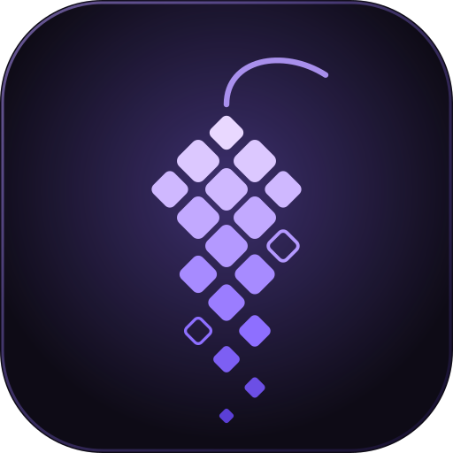
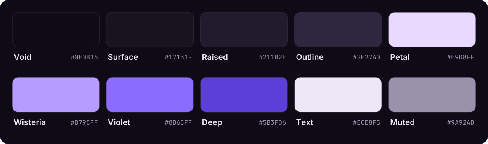
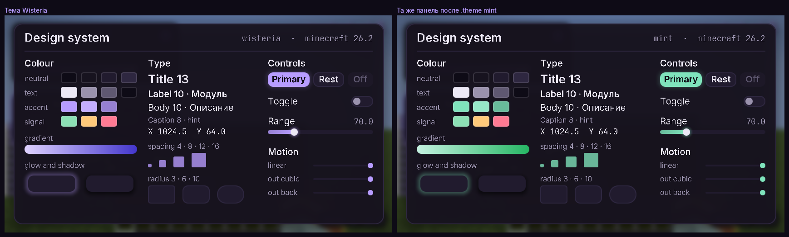
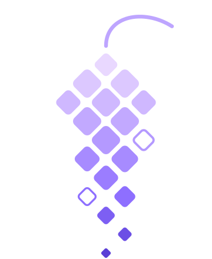

<p align="center">
  
</p>

<p align="center">
  
  
  
  
  
  <a href="LICENSE"></a>
</p>

<p align="center">
  <b>Wisteria</b> — утилити-клиент для Minecraft Java на Fabric, в котором дизайн идёт первым.<br>
  Свой GUI и HUD, единая система анимаций, встроенный музыкальный плеер и открытый код.<br>
  Сделан для анархии — прежде всего для 2b2t.
</p>

<p align="center">
  <a href="#что-будет-внутри">Что внутри</a> ·
  <a href="#палитра">Палитра</a> ·
  <a href="#дорожная-карта">Дорожная карта</a> ·
  <a href="#версии">Версии</a> ·
  <a href="#сборка">Сборка</a> ·
  <a href="SPEC.md">Спецификация</a>
</p>

> [!NOTE]
> Проект на старте. Готовы ядро (модули, настройки, конфиги с профилями, команды в чате) и дизайн-система
> (темы, свои шрифты, анимации), ClickGUI, своё главное меню и HUD с редактором расположения. Только Minecraft 26.2 и только Windows.
> Игровых модулей пока два, и они простые (FullBright, ESP). Релизов нет — собирать из исходников.
> Прокси для подключения убирает только связку аккаунтов по IP, анонимности не даёт — см. [docs/proxy.md](docs/proxy.md).

<p align="center"></p>

## Почему «Wisteria»



Глициния — лиана, которая цветёт лавандовыми каскадами и оплетает всё, до чего дотянется.
Хорошая метафора для клиента, который живёт на сервере, где вокруг спавна — выжженная пустошь:
**blooms where nothing grows**.

Знак собран из скруглённых ромбов — это блоки, сложенные в свисающую гроздь, от светлого лепестка
вверху до глубокого фиолетового на кончике. Тот же мотив дальше уходит в интерфейс:
каскадное появление строк в списке модулей, градиент акцента, падающие «лепестки» на сплэш-экране.

<br clear="right">

## Что будет внутри

| | Блок | Что это |
|---|---|---|
| ◆ | **Дизайн-система** | Палитра, типографика, шкала отступов и один `Animation`-хелпер на весь клиент — чтобы он выглядел цельным, а не набором окон. |
| ◆ | **ClickGUI** | Панели категорий, карточки модулей, раскрывающиеся настройки, поиск, color-picker (HSV + alpha + hex), смена темы на лету. |
| ◆ | **HUD** | Перетаскиваемые элементы с привязкой к краям и редактором: ArrayList, Watermark, координаты, TPS, таргет-инфо, уведомления. |
| ◆ | **Музыка** | Плеер для своих треков из `.minecraft/wisteria/music/`, громкость отдельно от игры, HUD-виджет с прогрессом и хоткеи. |
| ◆ | **Модули** | Упор на PvE: Xray с кластерами жил, BaseFinder со скорингом чанков, память инвентарей, безопасность. Каталог — в [PVE_BACKLOG.md](PVE_BACKLOG.md). |

Рисуем через рендер-абстракцию игры, без сырого OpenGL: в 26.2 уже есть переключение
OpenGL ↔ Vulkan, и всё, что написано в обход абстракции, сломается первым.

Про античит честно: дефолтные настройки модулей будут держаться в пределах Grim, а агрессивные режимы — выключены
и помечены. Но пока это план: [Grim-матрица](docs/grim-matrix.md) пуста, ни один модуль против Grim не проверен.

## Палитра

<p align="center"></p>

Тёмная база и лавандовый акцент. В клиенте это тема по умолчанию; роли цветов, состояния, остальные пресеты
и правила — в [дизайн-системе](docs/design-system.md).

<p align="center"></p>

<details>
<summary>Токены текстом</summary>

<br>

| Токен | Hex | Роль |
|---|---|---|
| `void` | `#0E0B16` | фон |
| `surface` | `#17131F` | панели |
| `raised` | `#211B2E` | карточки |
| `outline` | `#2E2740` | обводки |
| `petal` | `#E9D8FF` | блики, верх градиента |
| `wisteria` | `#B79CFF` | акцент |
| `violet` | `#8B6CFF` | активное состояние |
| `deep` | `#5B3FD6` | нажатое состояние, низ градиента |
| `text` | `#ECE8F5` | основной текст |
| `muted` | `#9A92AD` | вторичный текст |

</details>

## Дорожная карта

Порядок работ задают [SPEC.md](SPEC.md) и поправки к нему ([1](SPEC_AMENDMENT_1.md), [2](SPEC_AMENDMENT_2.md),
[3](SPEC_AMENDMENT_3.md)). Каждый шаг заканчивается рабочим билдом и коммитом.

| # | Что | Результат | Статус |
|:---:|---|---|:---:|
| **0** | Разведка | Рендер, события и звук проверены вживую — [находки](docs/stage0-findings.md) | ✅ |
| **1** | Ядро | Модули, настройки, события, конфиги с профилями, чат-команды, друзья/враги — [как устроено](docs/core.md), [как написать модуль](docs/module-api.md) | ✅ |
| **2** | Дизайн-система | Темы, шрифты, отступы, движение, эффекты одним шейдером и экран-справочник — [как устроено](docs/design-system.md) | ✅ |
| **3** | GUI | ClickGUI на правый Shift, все контролы настроек, темы, сплэш — [как устроено](docs/gui.md) | ✅ |
| **4** | HUD | 10 элементов, редактор с привязкой к краям и снапом, уведомления — [как устроено](docs/hud.md) | ✅ |
| **5** | Музыка | Плеер, HUD-виджет, хоткеи, звуки интерфейса | — |
| **6** | Флагманы | Xray Quality, BaseFinder Intel, база находок | — |
| **∥** | Fly Lab и Grim Lab | Режимы полёта как пресеты с самоограничением; авто-журнал флагов античита | — |
| **7** | Остальные модули | PvE-волны, затем travel, PvP — последним и осторожно | — |

Что не закрыто в этапе 0: список срабатываний Grim (нужен стенд), живой заход на 2b2t (нужен аккаунт),
проверка на настоящей видеокарте.

## Платформа

**Windows only.** Только Minecraft Java **26.2** на Fabric: другие версии игры и другие ОС не поддерживаются
и не тестируются (решение владельца, [AMENDMENT_4](SPEC_AMENDMENT_4.md)). Готовность проверяет шлюз —
автотест, который поднимает настоящий клиент, создаёт мир и проверяет рендер, ввод, пакеты, звук, модули и GUI,
включая пиксели кадра, а потом запускает игру второй раз и проверяет, что настройки сохранились.

## Стек

| | |
|---|---|
| **Java** | 25 |
| **Loader** | Fabric Loader 0.20.1, Fabric API — своя на каждую версию игры |
| **Сборка** | Fabric Loom 1.19.4, Gradle 9.8.2 |
| **Маппинги** | официальные имена Mojang — игра не обфусцирована, ремаппинга нет |
| **2D** | свои элементы в GUI-состоянии кадра: дробные координаты, градиент по углам, скругления шейдером |
| **3D** | `Gizmos` и событие сбора кадра из Fabric API |
| **Шейдеры** | GLSL 330; под Vulkan игра сама компилирует их в SPIR-V |
| **Pathfinding** | Baritone — официальный релиз v1.19.0 под 26.2 |

## Архитектура

```
src/main/java/dev/wisteria/
  module/ setting/ event/ command/ config/   ядро: модули и всё, на чём они стоят
  ui/                                        дизайн-система, ClickGUI, сплэш
  render/                                    Renderer2D, Renderer3D — тонкая обёртка над рендер-API игры
  platform/                                  ввод, звук, пакеты, чат, мир — интерфейсы и реализация (game/)
  mixin/                                     миксины
src/test/       модульные тесты без игры
src/gametest/   шлюз: автотест в настоящем клиенте
```

Рисуем только через рендер-API игры, без прямых вызовов OpenGL: в 26.2 бэкенд переключается между OpenGL и Vulkan,
и шлюз гоняется на обоих.

## Сборка

Нужен JDK 25.

```bash
./gradlew build
```

Jar появится в `build/libs/`. Запуск клиента для разработки:

```bash
./gradlew runClient
```

Модульные тесты (без игры, секунды) входят в `build`; отдельно:

```bash
./gradlew test
```

Шлюз — автотест в настоящем клиенте. На Windows:

```bash
./gradlew runClientGameTest
```

В Linux-контейнере без монитора, с повторным запуском и записью кадров в `build/gate/` (нужны Xvfb и Mesa):

```bash
tools/gate.sh VULKAN
```

## В игре

Команды вводятся в чат с точкой; Tab дополняет. Полный список и формат конфигов — в [docs/core.md](docs/core.md).

```
.modules                     что есть
.toggle esp                  включить или выключить
.bind esp g                  повесить на клавишу
.esp range 48                изменить настройку
.profile save mining         сохранить набор настроек под именем
.theme mint                  сменить тему; .theme accent #336699 — свой акцент
.design                      экран-справочник дизайн-системы
```

## Оговорки

- **Античит.** Пока ни один модуль не проверен против Grim. Результаты будут в [Grim-матрице](docs/grim-matrix.md);
  зелёная строка там значит «чисто на тестовом стенде», а не «безопасно на 2b2t».
- **Anti-xray.** «Обойти» его на клиенте нельзя: скрытые блоки сервер просто не присылает. Планируемое предсказание
  руд по сиду работает только для чанков ванильной генерации той же версии, что считает клиент, и только если сид известен.
  На старых мирах вроде 2b2t, сгенерированных разными версиями, оно ненадёжно.
- **Где это уместно.** Клиент сделан для анархических серверов и собственных тестовых стендов. Обход мер защиты
  (anti-xray, скрытый сид) допустим только там, где это разрешено правилами сервера.

## Структура репозитория

```
src/               код, см. «Архитектура»
docs/              ядро и команды, API модулей, дизайн-система, GUI, HUD, ESP, прокси и профили, находки этапа 0, Grim-матрица
tools/gate.sh      шлюз версии без монитора
tools/brand/       генератор SVG из assets/
assets/            логотип, баннер, палитра
SPEC*.md           спецификация и поправки владельца
PVE_BACKLOG.md     каталог PvE-фич с приоритетами
```

<details>
<summary>Как пересобрать бренд-ассеты</summary>

<br>

Все SVG в `assets/` генерируются одним скриптом. Текст в них переведён в кривые,
поэтому картинки одинаково выглядят на любой машине.

```bash
pip install fonttools
```

```bash
python3 tools/brand/generate.py
```

Нужны установленные шрифты Inter и JetBrains Mono (оба под SIL OFL 1.1). Пути к ним
заданы в начале скрипта в словаре `FONTS`.

</details>

## Принципы

- **Открытые исходники.** Логика модулей опирается на GPL-клиенты (Wurst, Meteor, LiquidBounce и другие),
  поэтому проект целиком под GPL-3.0. В каждом файле с портированной логикой — ссылка на источник и его лицензию.
- **Чистые билды.** Никакой малвари, никакого сбора данных, никаких токенов и кошельков. Что в исходниках, то и в jar.
- **Только там, где это уместно.** Клиент сделан для анархии. На серверах с правилами за такие моды банят — и по делу.
- **Узкий фокус.** Одна ниша модулей, доведённая до ума, вместо сотни полурабочих.

## Лицензия

[GPL-3.0](LICENSE). В jar входят шрифты Inter и JetBrains Mono под SIL OFL 1.1 — их лицензия лежит рядом
(`LICENSE_fonts.txt`). Wisteria — независимый проект, не связанный с Mojang и Microsoft.
Minecraft — товарный знак Mojang Synergies AB.

<p align="center"></p>

<p align="center"></p>
