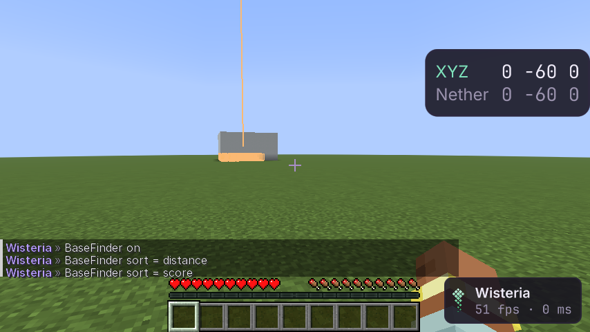

# BaseFinder

Ищет следы игроков в каждом чанке, который прислал сервер, оценивает чанк и ведёт список по серверу. Модуль
**BaseFinder** в панели World ClickGUI. Пассивный: только читает уже полученные чанки, на сервер ничего не уходит
(проверено аудитом).

> **Видно только то, что прислал сервер.** Дальность обзора решает сервер (view distance); `Range` больше неё ничего
> не добавит. Чанк, который сервер не прислал, просканировать нельзя.

## Что считается следом

| Вид | Вес | Блоки |
|---|---|---|
| Storage | 3 | сундуки, бочки, шалкеры, эндер-сундуки |
| Redstone | 4 | поршни, наблюдатели, повторители, компараторы, воронки, выбрасыватели, крафтер… |
| Utility | 5 | маяк, стол зачарований, наковальни, варочная стойка, якорь возрождения, блоки алмазов… |
| Building | 1 | бетон, стекло, шерсть, кровати, кварц, глазурованная керамика, свет |
| Portal | 5 | горящий портал в Незер |
| Spawner | 2 | спавнер — только вместе с другими следами (одинокий спавнер — это данж) |

**Оценка чанка** — по каждому включённому виду: вес × (1 + ln(число)). Первый блок вида значит больше всего, стена
из тысячи стёкол не перевешивает сундуки и редстоун. Чанк попадает в список при оценке от `Min Score` (по умолчанию 10)
и от `Min Blocks` следов (3). Деревня с сундуком, кроватью и окном (≈ 5) и данж (0) — ниже порога.

## Меню

| Настройка | Что |
|---|---|
| `Found` | список: оценка · расстояние · координаты середины следов · что нашлось; кнопка убирает строку |
| `Sort` | по оценке или по расстоянию |
| `Rescan`, `Clear` | просканировать загруженное заново; забыть всё по этому серверу |
| виды следов | тумблер на каждый вид |
| `Range`, `Min Score`, `Min Blocks`, `Limit` | дальность сканирования, пороги, сколько хранить (лучшие) |
| `Budget` | миллисекунд на кадр для сканирования (по умолчанию 1,5) |
| `Highlight`, `Beams`, `Color` | рамки вокруг найденных блоков сквозь стены (`BoxBatch`), луч над каждым чанком |
| `Notify` | тост, когда в списке появляется новый чанк |
| `Status` | сколько в списке, сколько ждёт, сколько мс на чанк |

Метки Waypoints: модуля Waypoints в клиенте пока нет; вместо меток — лучи в мире и координаты в списке.

## Как устроено

- Пришёл чанк (или в нём поставили или сломали блок-след) — он в очереди. Каждый кадр сканируются ближайшие к игроку,
  пока не кончится `Budget`. Секция, в палитре которой нет ни одного блока-следа, пропускается без перебора.
- Список хранится **в профиле, отдельно для каждого сервера**: `profiles/<профиль>/data/basefinder/found/<хеш сервера>.json`
  (адрес сервера внутри файла, имя — хеш, чтобы в имени файла не было адреса). Сохраняется раз в 5 с при изменениях
  и при выходе.

## Как проверено

- **Модульные тесты** (`BaseLogicTest`): какой блок — какой след; база оценена выше деревни и данжа, стена стекла
  не перевешивает маленькую базу, выключенный вид не считается; сортировка обоими способами и ограничение списка.
- **Шлюз** (`BaseFinderGameTest`, OpenGL и Vulkan): сервер строит большую и маленькую базу, данж и «хижину»;
  обе базы в списке, большая выше, данжа и хижины нет; худший кадр сканирования — в пределах бюджета; сортировка;
  база, построенная на глазах, находится; список переживает выключение; строка, удалённая в меню, пропадает.
- **Аудит сети**: BaseFinder включён 5 с — сервер получает те же пакеты, что и без него.
