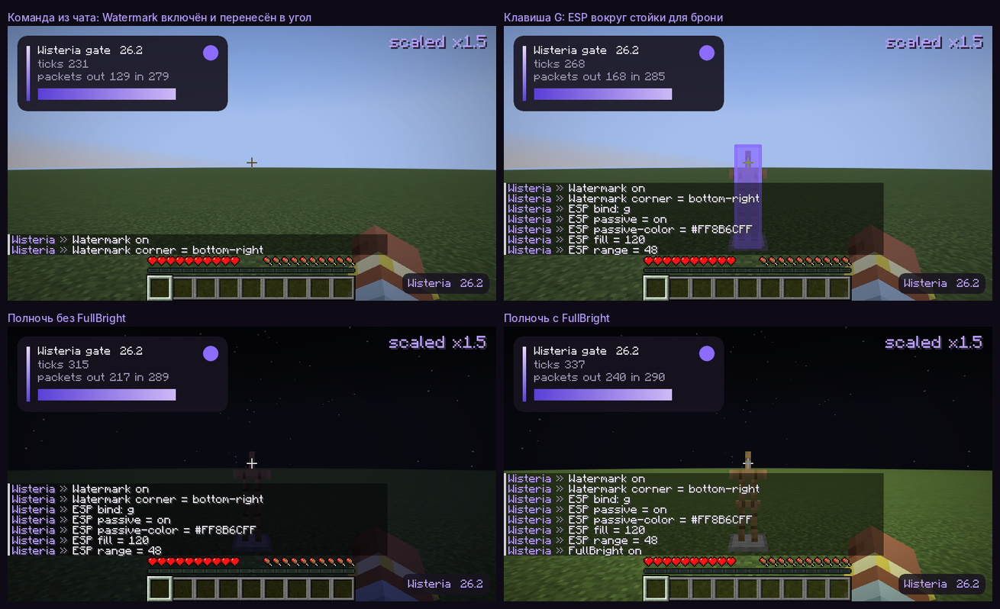

# Ядро

Этап 1: каркас, на который вешается всё остальное. Как написать свой модуль — в [module-api.md](module-api.md).



## Что есть

| Часть | Класс | Что делает |
|---|---|---|
| Модули | `Module`, `ModuleManager`, `Category` | Реестр, включение и выключение, бинды, категории |
| Настройки | `setting.*` | bool, int/float/double со слайдером, enum, цвет ARGB, клавиша, строка; каждая умеет в JSON и в текст |
| События | `EventBus`, `Events` | tick, render2D, render3D, клавиша, пакет ↑ и ↓ (отменяемые) |
| Конфиги | `ConfigManager` | JSON в `.minecraft/wisteria/`, профили, отложенная запись |
| Команды | `CommandManager`, `Commands` | Команды в чате с префиксом и автодополнением по Tab |
| Друзья и враги | `Relations` | Два списка имён; ESP красит по ним игроков |

Первые модули — `FullBright`, `ESP` и `Watermark`. Это рабочие, но намеренно простые версии:
на них проверяется каркас.

## Команды

Всё, что начинается с префикса (по умолчанию `.`), выполняется в клиенте и на сервер не уходит.
Tab в чате дополняет команды, модули, настройки и их значения.

| Команда | Что делает |
|---|---|
| `.help [команда]` | Список команд или справка по одной |
| `.modules` | Модули по категориям |
| `.toggle <модуль> [on\|off]`, `.t` | Включить или выключить |
| `.bind <модуль> [клавиша\|none]`, `.b` | Показать или сменить бинд |
| `.set <модуль> [настройка] [значение]`, `.s` | Показать или сменить настройки |
| `.reset <модуль> [настройка]` | Вернуть значения по умолчанию |
| `.friend add\|remove <имя>`, `.friend list`, `.f` | Список друзей |
| `.enemy add\|remove <имя>`, `.enemy list` | Список врагов |
| `.profile list`, `.profile load\|save\|delete <имя>`, `.p` | Профили настроек |
| `.prefix [символы]` | Показать или сменить префикс |
| `.theme [пресет]`, `.theme accent <#цвет>` | Показать или сменить тему интерфейса |
| `.design` | Открыть [экран-справочник дизайн-системы](design-system.md) |

Имя модуля — тоже команда: `.esp` переключает, `.esp range` показывает настройку, `.esp range 48` меняет.

Клавиши задаются именами: `g`, `f6`, `right_shift`, `numpad_1`. Числовых кодов в конфигах нет:
так конфиг читается и человеком. Бинд срабатывает по нажатию в самой игре —
не во время набора в чате и не в меню.

## Файлы

```
.minecraft/wisteria/
  client.json            активный профиль, префикс команд и тема
  social.json            друзья и враги — общие для всех профилей
  profiles/default.json  какие модули включены, их бинды и настройки
  profiles/<имя>.json
```

- Изменения пишутся через пару секунд после последнего и ещё раз при выходе из игры.
- Запись идёт через временный файл с переименованием: полфайла на диске не останется.
- Файл, который не удалось прочитать, откладывается как `*.broken`, клиент стартует с настройками по умолчанию.
- Неизвестные модули и настройки в файле пропускаются, значения вне диапазона приводятся к границе —
  профиль от другой версии клиента не ломает запуск.

## Как написать модуль

См. [module-api.md](module-api.md).

## Как проверено

- **Модульные тесты** (`./gradlew test`, без игры, секунды): тесты на настройки, модули и бинды,
  команды с автодополнением, конфиги, профили и чтение испорченных и вручную правленных файлов.
- **Шлюз** (`tools/gate.sh`) в настоящем клиенте 26.2, OpenGL и Vulkan:
  - команда из чата включает `Watermark`, он виден в кадре, на сервер команда не уходит;
  - `.tog` + Tab, Tab в настоящем чате превращается в `.toggle`;
  - клавиша `G` включает `ESP`, бокс вокруг сущности виден в кадре; повторное нажатие выключает;
  - `FullBright` в полночь поднимает яркость земли в кадре с ~21 до ~66 из 255;
  - **второй запуск игры** над тем же каталогом находит профиль, включённый модуль, бинд, настройки и друга.

Чего здесь нет: проверки против античита. Три модуля этапа только рисуют и ничего не шлют серверу,
но в [Grim-матрицу](grim-matrix.md) их всё равно стоит внести при первом живом тесте.
