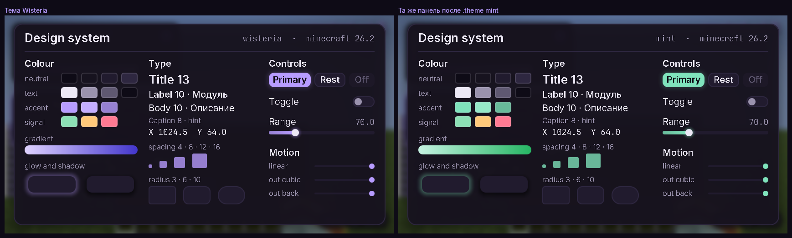

# Дизайн-система

Этап 2. Общий язык всего интерфейса: цвет по ролям, шрифты, отступы, движение и эффекты.
ClickGUI и HUD (этапы 3–4) собираются только из этого — без своих цветов и своих анимаций по месту.



Это настоящие кадры игры (26.2). Экран открывается командой `.design`, тема меняется командой `.theme`
и применяется со следующего кадра. Код — в `core/src/main/java/dev/wisteria/ui/`.

## Цвет

Виджеты спрашивают у темы роль («поверхность», «акцент»), а не hex. Тема — запись `Theme`;
текущая — `client.themes().current()`.

Тема собирается из двух половин: **нейтральная база** и **один акцентный цвет**. Состояния акцента
(наведение, нажатие), цвет текста на акценте и фирменный градиент выводятся из него автоматически,
поэтому любой цвет, заданный пользователем, сразу даёт полную рабочую тему.

### База (тёмная)

| Роль | Hex | Где |
|---|---|---|
| `background` | `#0E0B16` | затемнение позади экранов |
| `surface` | `#17131F` | панели |
| `raised` | `#211B2E` | карточки и контролы на панели |
| `hover` | `#2A2339` | контрол под курсором |
| `outline` | `#2E2740` | волосяные линии, рамки |
| `text` | `#ECE8F5` | основной текст |
| `textMuted` | `#9A92AD` | подписи, вторичный текст |
| `textDisabled` | `#5F5871` | недоступные контролы |
| `success` / `warning` / `danger` | `#8CE0B5` / `#FFC97A` / `#FF7A93` | сигналы |

Светлая база заложена структурой (`Theme.Base.LIGHT`), но не настроена и в пресетах не используется.

### Акцент

| Пресет | `accent` | `accentHover` | `accentPressed` | Градиент |
|---|---|---|---|---|
| `wisteria` (по умолчанию) | `#B79CFF` | `#C4AEFF` | `#9680D1` | `#DFD2FF` → `#4336CC` |
| `sakura` | `#FF9EC4` | `#FFAFCF` | `#D182A1` | `#FFD3E4` → `#CC378C` |
| `mint` | `#7FE3BC` | `#96E8C8` | `#68BA9A` | `#C5F2E1` → `#26B664` |
| `ember` | `#FFB07A` | `#FFBE92` | `#D19064` | `#FFDBC3` → `#CC421A` |
| `frost` | `#8CC8FF` | `#A1D2FF` | `#73A4D1` | `#CBE6FF` → `#299BCC` |

Правила вывода: наведение — на 18 % светлее, нажатие — на 18 % темнее; текст на акценте — тёмный или белый
по яркости акцента; градиент идёт от осветлённого акцента к более насыщенному и тёмному соседу по тону.

`.theme mint` — пресет, `.theme accent #336699` — свой акцент поверх текущего пресета.
Выбор хранится в `client.json` и переживает перезапуск.

Семантика состояний: **включено — акцент, выключено — приглушённое** (`raised` + `textMuted`).
Акцент не используется как украшение: если что-то лавандовое, оно активно или в фокусе.

## Шрифты

| Стиль | Гарнитура | Размер | Для чего |
|---|---|---|---|
| `Type.TITLE` | Inter SemiBold | 13 | заголовки окон и секций |
| `Type.LABEL` | Inter SemiBold | 10 | имена модулей, подписи кнопок |
| `Type.BODY` | Inter Regular | 10 | имена настроек, описания |
| `Type.CAPTION` | Inter Regular | 8 | подсказки, вторичные строки |
| `Type.MONO` | JetBrains Mono | 9 | числа: значения, координаты, клавиши |

Размеры — в GUI-пикселях (высота кегля), строка — 1.25 кегля. Числа, которые меняются на глазах,
всегда моноширинные — чтобы соседний текст не дёргался.

Шрифты идут через штатный TrueType-провайдер игры и её атлас глифов, поэтому работают на OpenGL и Vulkan
без своего кода. Растеризация — в 4× от базового размера 16, так что текст остаётся чётким при масштабе GUI до 4.
Кириллица есть в обеих гарнитурах.

Ограничения: игра не делает кернинг пар и принимает только TrueType-контуры (CFF-сборка Inter не загрузилась,
поэтому взята TrueType-сборка автора). Оба шрифта под SIL OFL 1.1, лицензия лежит в jar как `LICENSE_fonts.txt`.

## Отступы, радиусы, линии

| | Значения | Константы |
|---|---|---|
| Отступы | 4 · 8 · 12 · 16 | `Space.XS`, `S`, `M`, `L` |
| Радиусы | 3 — мелкие контролы; 6 — кнопки, карточки; 10 — панели; «пилюля» — половина высоты | `Radius.S`, `M`, `L`, `Radius.pill(h)` |
| Линии | 1 — волосяная; 1.5 — фокус | `Stroke.HAIRLINE`, `FOCUS` |

Координаты дробные: элемент может стоять между пикселями, поэтому анимации не «шагают».

## Движение

Всё, что движется, держит `Animation` и читает `value()` каждый кадр. Своих интерполяций в виджетах нет.

```java
private final Animation hover = new Animation(0.0F, Animation.FAST, Easing.OUT_CUBIC);
// в отрисовке:
this.hover.animateTo(isHovered);
int fill = Colors.mix(theme.accent(), theme.accentHover(), this.hover.value());
```

| Длительность | мс | Для чего |
|---|---|---|
| `Animation.FAST` | 120 | наведение, нажатие |
| `Animation.NORMAL` | 200 | тумблер, раскрытие настроек |
| `Animation.SLOW` | 350 | открытие и закрытие экрана |

| Кривая | Для чего |
|---|---|
| `OUT_CUBIC` | по умолчанию: появление, перемещение на место |
| `IN_OUT_CUBIC` | из одного покоя в другой: ползунок слайдера |
| `OUT_QUINT` | длинная мягкая посадка: открытие экрана |
| `OUT_BACK` | лёгкий перелёт: тумблеры, мелкие подтверждения |
| `LINEAR` | прогресс и всё, что отражает реальное время |

Время — настоящее, не тики и не кадры: движение одинаково на 30 и 300 fps и не замирает на паузе.
(В SPEC стояло «интерполятор с дельта-тик»; настоящее время решает ту же задачу без привязки к 20 тикам в секунду.)
Смена цели на лету продолжает движение с текущего значения — рывков нет.

## Эффекты

Всё рисует один шейдер — скруглённый прямоугольник как поле расстояний (`panel.fsh`):

| Вызов `Renderer2D` | Что даёт |
|---|---|
| `roundedRect`, `roundedGradient` | заливка со сглаженными углами, цвет на каждый угол |
| `roundedOutline` | обводка внутри края |
| `shadow` | мягкий ореол: тень тёмным цветом, свечение — акцентным |
| `blurBehind` | размытие всего, что нарисовано раньше |

Параметры фигуры едут в вершинах (формат `ENTITY`), своих uniform-ов нет — поэтому шейдер одинаково работает
на OpenGL и Vulkan и на всех трёх версиях игры.

Правила: тень — под панелями и окнами, чёрная, сдвиг вниз на 4, размытие 18. Свечение — только у активного
акцента (основная кнопка, ползунок), размытие 4–7. Обводка — волосяная, цветом `outline`.

**Чего нет:** размытия только под панелью («матовое стекло»). Игра умеет размывать кадр целиком и один раз за кадр;
за экранами оно включено, за панелями HUD — нет. Свой проход размытия — отдельная задача, не сделана.

## Как пользоваться

```java
Theme theme = client.themes().current();
renderer.shadow(x, y + 4, w, h, Radius.L, 18, Colors.withAlpha(theme.shadow(), 150));
renderer.roundedRect(x, y, w, h, Radius.L, theme.surface());
renderer.roundedOutline(x, y, w, h, Radius.L, Stroke.HAIRLINE, theme.outline());
Type.TITLE.draw(renderer, "Modules", x + Space.M, y + Space.S, theme.text());
```

Чего делать нельзя: hex-цвета в виджетах, размеры шрифта числом мимо `Type`, отступы мимо шкалы,
интерполяция «вручную» мимо `Animation`.

## Как проверено

- **Модульные тесты** (`./gradlew :core:test`): арифметика цвета и HSV, кривые, `Animation` на подставных часах
  (в том числе смена цели на лету), вывод темы из акцента, пресеты, сохранение темы через перезапуск.
- **Шлюз** в настоящем клиенте на 26.1.2, 26.2, 26.3, OpenGL и Vulkan: шрифты действительно загрузились
  (непропорциональные «квадратики» вместо глифов ловятся по ширине строк), обводка и свечение видны в кадре,
  экран-справочник открывается командой, образец акцента в кадре равен `#B79CFF`, после `.theme mint` — `#7FE3BC`,
  тема переживает второй запуск игры.

Не проверено: настоящая видеокарта, большие масштабы GUI, производительность (60+ fps с открытым GUI — контроль этапа 3).
