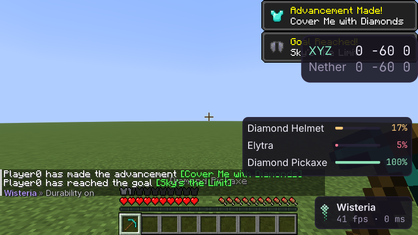

# Durability

Элемент HUD **Durability**: прочность брони (шлем, нагрудник или элитры, поножи, ботинки) и предметов в руках —
полоса и процент на каждую вещь. Пассивный: читает только свои предметы, на сервер ничего не уходит (аудит сети);
паника его гасит.

| Настройка | Что |
|---|---|
| `Armor`, `Hands` | что показывать |
| `Percent` | процент; выключено — сколько использований осталось |
| `Warn At` | ниже этого процента вещь «изношена» (жёлтая); ниже половины от него — «критично» (красная, мигает) |
| `Alarm`, `Alarm Sound` | тост и звук (слышен только вам), **один раз** при переходе вещи в худшую зону |
| `Scale` и место | как у любого элемента HUD, в редакторе |

Чат: `.durability <настройка> <значение>`.

## Дизайн

- Вещи без прочности не показываются; элемент без вещей не рисуется.
- Тревога сравнивает зоны с прошлым тиком: повторов, пока вещь остаётся в той же зоне, нет; починили — тихо;
  надели уже изношенную — один тост.
- Звук — `SimpleSoundInstance.forUI` у себя, пакетов не создаёт; во время паники молчит.

## Как проверено

- Модульные тесты: зоны и граница, остаток и подписи, тревога по переходам (ровно один раз).
- Шлюз (`DurabilityGameTest`): шлем, элитры, кирка; тосты «low» и «critical»; износ шлема до критичного — ровно один
  новый тост и без повтора; `Hands` выключается; кадр. Аудит сети: элемент включён — пакеты те же.
