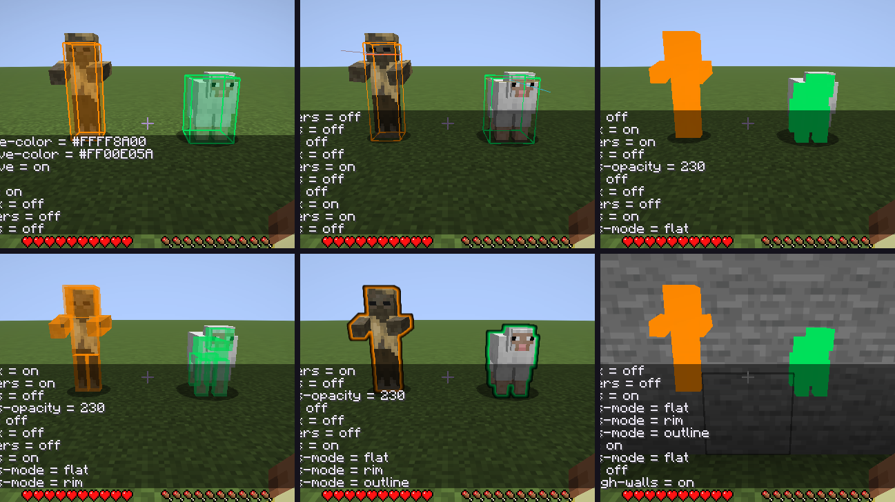

# ESP

Подсветка игроков, мобов, предметов и контейнеров. Один модуль, **ESP** в панели Render ClickGUI; все настройки — там
же (и командами `.esp <настройка> <значение>`). Только рисует: на сервер ничего не уходит.

## Стили

Включаются в любом сочетании: каждый — отдельный тумблер со своими настройками под ним. По умолчанию — только Box.

| Стиль | Что рисует | Настройки |
|---|---|---|
| **Box** | рамка вокруг сущности, по желанию с заливкой | `Box Width`, `Box Fill` (0 — только рамка) |
| **Hitbox** | настоящий хитбокс, квадрат на уровне глаз и линия взгляда на 2 блока | `Hitbox Width`, `Hitbox Gaze` |
| **Corners** | только уголки рамки | `Corners Width`, `Corner Length` (доля ребра) |
| **Chams** | сама модель, залитая цветом (мобы и игроки) | `Chams Mode`, `Chams Opacity`, `Chams Pulse` |

Режимы чамсов: **Flat** — ровная заливка; **Rim** — светится силуэт, середина почти прозрачная; **Outline** —
контур игры (как у эффекта свечения) в цвете роли. `Chams Pulse` — заливка «дышит» от 40 до 100 % непрозрачности.

## Кого и каким цветом

- **Роли и цвета:** игрок, друг, враг (списки `.friend` и `.enemy`), враждебный моб, мирный моб, предмет, контейнер.
  Цвет роли — общий для всех стилей; отдельных цветов «виден / за стеной» нет.
- **Фильтры:** `Players`, `Hostile`, `Passive`, `Items`, `Containers` (сундуки, бочки, шалкеры, эндер-сундуки, воронки,
  печи…; для них — Box и Corners), `Range` — дальность в блоках.
- **Through Walls** — один переключатель на весь ESP, по умолчанию включён: всё рисуется поверх блоков;
  выключен — блоки впереди закрывают и рамки, и чамсы.

## Как устроены чамсы

Проба осуществимости, по итогу — работают на OpenGL и Vulkan без сырого OpenGL:

- **Flat и Rim.** Когда игра отправляет модель сущности на отрисовку, клиент отправляет ту же модель второй раз
  со своим конвейером (`RenderPipeline` из штатного построителя) и своим шейдером `wisteria:core/chams`. Шейдер
  берёт из вершин только позицию, цвет и нормаль: цвет роли, а у Rim прозрачность растёт к силуэту (по углу между
  нормалью и направлением взгляда). Через стены — сравнение глубины «всегда», без — обычное, запись глубины выключена.
  Решение «кому чамсы» принимается один раз за кадр, когда игра копирует сущность в своё состояние отрисовки.
- **Outline.** Ничего своего: цвет контура свечения, который игра и так умеет рисовать поверх всего.
- **Чего нет:** чамсы покрывают модель, но не слои поверх неё — шерсть овцы, броню, предметы в руках
  (они рисуются как обычно). Предметы на земле получают только Box и Corners.
- **Цена:** вторая отправка той же модели. В автотесте с 50 овцами и всеми четырьмя стилями сам ESP тратит
  0,1–0,14 мс процессора на кадр; на программной видеокарте шлюза кадр становится длиннее на ~3 мс из 25–30
  (это растеризация второй модели, на настоящей видеокарте она дешевле).

## Как проверено

- **Модульные тесты:** умолчания (Box, сквозь стены), любые сочетания стилей и сколько линий каждый рисует,
  цвета по ролям с друзьями и врагами, фильтры, контейнеры, условия чамсов, сохранение через перезапуск,
  геометрия уголков, взгляда и пульсации.
- **В игре** (`EspGameTest`, OpenGL и Vulkan): хаск и овца перед камерой, кадр на каждый стиль и сочетание, три режима
  чамсов; за каменной стеной чамсы видны со `Through Walls` и пропадают без него (0 пикселей цвета роли);
  50 овец в кадре со всеми стилями.

Не проверено: 60 fps на настоящей видеокарте при 50 сущностях. В шлюзе видеокарта программная, а время кадра
там от ESP не зависит; на своей машине — F3 или `.bench`.
