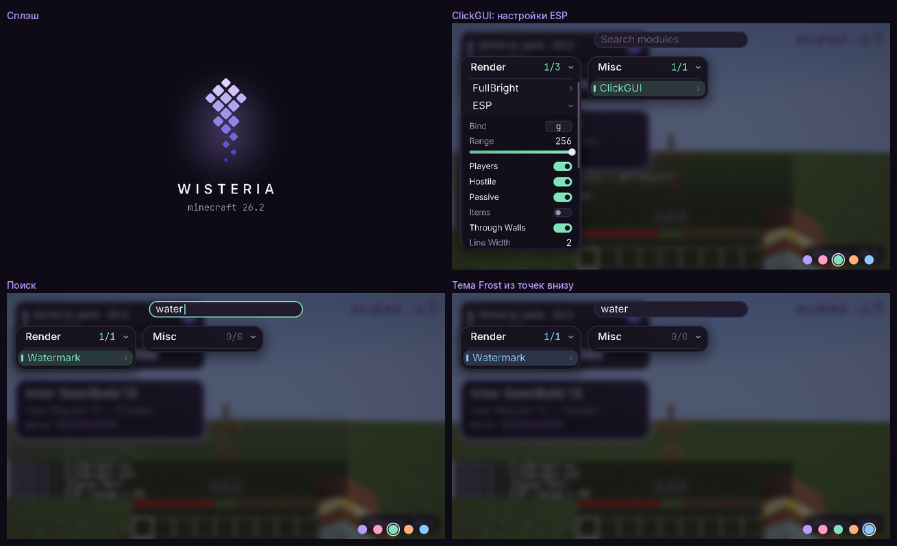

# ClickGUI

Этап 3. Браузер модулей, построенный только из [дизайн-системы](design-system.md).

## Управление

| Действие | Как |
|---|---|
| Открыть и закрыть | **Правый Shift** (бинд модуля ClickGUI, меняется как любой другой) или Escape |
| Включить модуль | левый клик по строке |
| Настройки модуля | правый клик по строке — раскрываются под ней |
| Переместить панель | тянуть за заголовок; положение запоминается |
| Свернуть панель | правый клик по заголовку |
| Прокрутка | колесо над панелью |
| Поиск | просто начать печатать; Ctrl+Backspace очищает |
| Тема | цветные точки в правом нижнем углу |

Контролы настроек: тумблер, слайдер (правый клик — значение по умолчанию), выпадающий список, выбор цвета
(квадрат насыщенности и яркости, полосы тона и прозрачности, поле hex), запись бинда (клик, затем клавиша;
Escape снимает бинд), текстовое поле. Подсказка к тому, что под курсором, — в строке внизу слева.

При запуске игры поверх главного меню один раз проигрывается сплэш: знак «распускается» по лепестку и уходит
в меню. Любая клавиша или клик пропускает его.

## Как проверено

- **Модульные тесты** (`./gradlew test`): клики, перетаскивание слайдера за край, запись бинда и Escape,
  поиск, свёртывание и перемещение панелей с сохранением через перезапуск, смена темы точкой, подсказки;
  каждый кадр проверяется на парность scissor и трансформаций.
- **Шлюз** в настоящем клиенте: правый Shift открывает и закрывает, клик настоящей мышью переключает модуль,
  слайдер ставится кликом и тянется, набор текста фильтрует список, точка меняет тему, сплэш рисуется и
  закрывается сам. Разметка и отправка кадра GUI занимают 0.14–0.25 мс процессора — далеко от бюджета 16.7 мс
  для 60 fps.

Не сделано: перерисовка главного меню игры под бренд (в SPEC помечено как опциональное).
