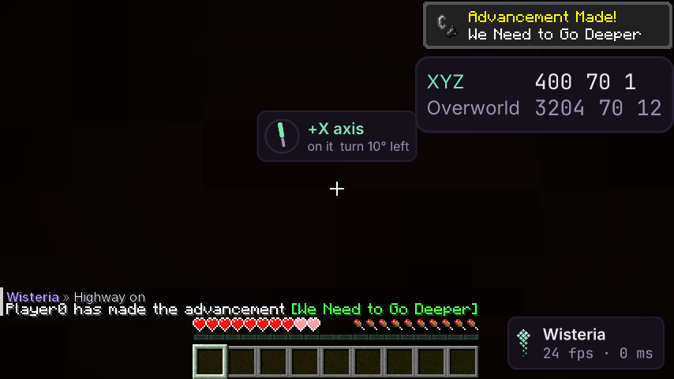

# Highway

Элемент HUD **Highway**: ближайший хайвей Незера, насколько вы от него и куда идти, и стрелка направления движения
по нему относительно взгляда. Пассивный: только координаты игрока, на сервер ничего не уходит (аудит сети);
паника его гасит.

## Что считается хайвеем

| Вид | Где | Направление движения |
|---|---|---|
| Оси (`Axes`) | +X, −X, +Z, −Z от 0 0 | от центра |
| Диагонали (`Diagonals`) | `x = z`, `x = −z` в четырёх четвертях | от центра |
| Кольцевые (`Ring Roads`) | квадраты `max(|x|, |z|) = R`, радиусы списком: `1000 5000` | по часовой (вид сверху) |

## Что показывает

- Имя ближайшего: `+X axis`, `+X+Z diagonal`, `ring 1000` — зелёным, если вы на нём (`On Width`, по умолчанию 2 блока).
- Строка: `on it` или `12 off · go N` (куда до ближайшей точки, 8 сторон, север — −Z) и `turn 5° right` /
  `heading along` — насколько повернуть, чтобы идти вдоль.
- Стрелка: вверх — куда вы смотрите, стрелка — направление движения по хайвею.
- `Nether Only` (по умолчанию вкл): в других измерениях элемент скрыт.

Чат: `.highway <настройка> <значение>`, например `.highway ring-roads 1000 5000`.

## Как проверено

- Модульные тесты: оси, диагонали, кольца (сторона и направление), ничего не включено, подсказка, повороты через ±180°,
  стороны света.
- Шлюз (`HighwayGameTest`): в Верхнем мире при `Nether Only` — пусто; в Незере на оси +X — `on it` и кадр; диагональ
  в 3 блоках; кольцо из меню. Аудит сети: элемент включён — пакеты те же.
