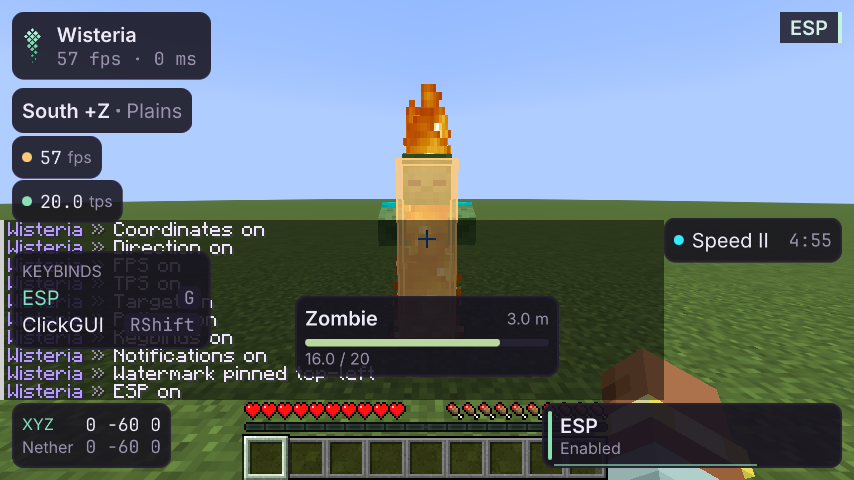
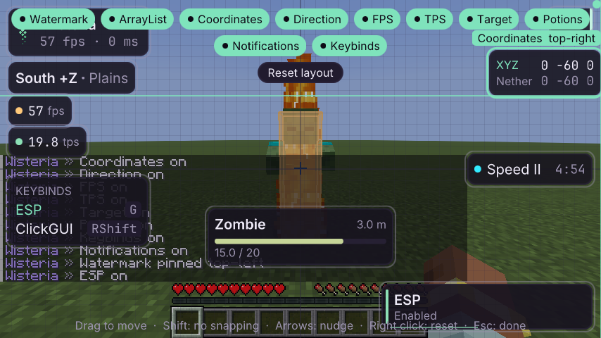

# HUD

Этап 4. Информация поверх игры, построенная только из [дизайн-системы](design-system.md). Каждый элемент — модуль
категории **HUD**: включается в ClickGUI, командой (`.fps`) или в редакторе, у каждого есть настройка `Scale`.

## Элементы

| Элемент | Что показывает | Где по умолчанию |
|---|---|---|
| Watermark | знак, название, fps и пинг (версия — по настройке) | левый верхний угол |
| ArrayList | включённые модули, длинные сверху; въезжают и уезжают, цвет — по фирменному градиенту | правый верхний |
| Coordinates | XYZ и пересчёт в другое измерение (Overworld ↔ Nether, 8:1) | левый нижний |
| Direction | сторона света с осью (`South +Z`) и биом | слева сверху |
| FPS | кадры в секунду; точка: зелёная от 60, жёлтая от 30, красная ниже | слева сверху |
| TPS | тики сервера в секунду по игровому времени, которое сервер присылает раз в секунду; если обновлений нет 3 с — «no ticks» | слева сверху |
| Target | то, что под прицелом: имя, полоса здоровья, расстояние; держится 3 с после отвода взгляда | под прицелом |
| Potions | эффекты: цвет, название с уровнем, оставшееся время; последние 10 с мигают | справа посередине |
| Notifications | тосты: модуль включён или выключен, смерть; остальные части клиента шлют свои | правый нижний |
| Keybinds | модули с биндом, клавиша; включённые подсвечены | слева |

Элемент, которому нечего показать (нет цели, нет эффектов), не рисуется. Появляется и исчезает он плавно:
прозрачность и сдвиг на несколько пикселей от края, к которому он привязан.

## Редактор

Открывается командой `.hud` или модулем **HUD Editor** в ClickGUI.

| Действие | Как |
|---|---|
| Переместить | тянуть мышью |
| Включить или выключить элемент | чип с его именем вверху |
| Вернуть элемент на место | правый клик по нему, или Delete |
| Вернуть всё | «Reset layout» (активна, только если что-то сдвинуто) |
| Сдвинуть на пиксель / на клетку | стрелки / Shift + стрелки |
| Без привязки | держать Shift во время перетаскивания |
| Выйти | Escape |

**Привязка при перетаскивании**, по порядку: края экрана (в пределах 4 px — всегда к краю); середины экрана,
края и центры других элементов (с направляющей линией); иначе — сетка 8 px.

**Якорь** — точка экрана, от которой отсчитывается положение: один из девяти (углы, середины сторон, центр).
Выбирается сам по трети экрана, где оказался центр элемента. Поэтому при смене размера окна элемент
в правом углу остаётся у правого края, а элемент по центру — по центру.

## Команды

| Команда | Что делает |
|---|---|
| `.hud` | открыть редактор |
| `.hud <элемент> <якорь> [x y]` | поставить элемент, например `.hud coordinates top-right` или `.hud fps center 0 40` |
| `.hud reset [элемент]` | вернуть один элемент или все |
| `.hud list` | где сейчас каждый элемент |

Якоря: `top-left`, `top`, `top-right`, `left`, `center`, `right`, `bottom-left`, `bottom`, `bottom-right`.
Расположение хранится в `.minecraft/wisteria/client.json` (`"hud"`), как и раскладка ClickGUI: оно про экран,
а не про профиль. Включённость и настройки элементов — в профиле, как у любого модуля.

## Свой элемент

Наследник `HudElement` в своей папке модуля: `measure(context)` возвращает размер или `null`, `draw(context, w, h)`
рисует в точке 0, 0 через `context.panel(...)`, `context.text(Type…)`, `context.bar(...)`. В редакторе
(`context.preview()`) — образец, чтобы элемент можно было поставить. Логику — чистыми функциями, как
`Coordinates.rows(...)`. Пример поменьше — `modules/hud/Fps.java`. Тост из любого места —
`client().hud().notify(заголовок, текст, Toasts.Kind.INFO)`.

## Как проверено

- **Модульные тесты** (`./gradlew test`): расстановка от каждого якоря и удержание на экране, выбор якоря
  по трети экрана и его сохранение при смене размера, привязка к краям, середине, другим элементам и сетке,
  приоритет края экрана; редактор мышью (перетащить, правый клик, стрелки), обход всех его контролов
  `ControlWalker`; сохранение через перезапуск и команда `.hud`; тосты на включение модулей; чистая логика
  каждого элемента (пересчёт в Nether, сторона света, TPS по игровому времени, время эффектов, подписи клавиш).
- **Шлюз** (`HudGameTest`, OpenGL и Vulkan): в настоящем мире с зомби под прицелом и эффектом скорости
  все 10 элементов рисуются с настоящими данными и видны в кадре; TPS встроенного сервера ≈ 20;
  настоящей мышью Coordinates перетаскивается в правый верхний угол и встаёт ровно к краю; Escape закрывает редактор;
  **второй запуск игры** находит элемент там же.

Не сделано: медиа-виджет (этап 5, нужен компьютер владельца с играющей музыкой, A5 §6).
