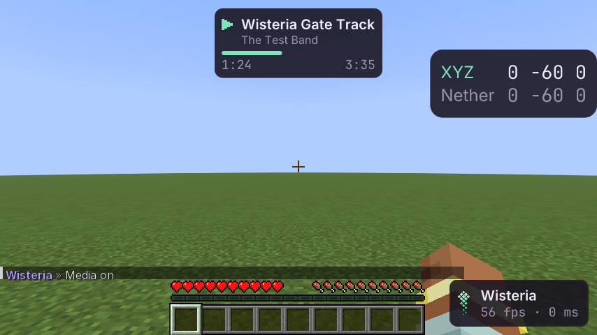

# Медиа-виджет

Элемент HUD **Media**: что сейчас играет на компьютере — название, исполнитель, прогресс — и кнопки
«пауза/играть», «дальше», «назад». Данные — из системных медиа-контролов Windows (SMTC, то же, что показывает
всплывающее окно громкости): Spotify, браузер, Яндекс Музыка, плеер Windows — любой, кто туда пишет.

> **Нужна живая проверка владельцем.** В облаке нет Windows и играющей музыки: шлюз проверяет виджет на
> поддельном источнике, а вызовы Windows — на подставных COM-объектах. Проверка: Windows 10/11, включить музыку
> (Spotify, браузер), включить Media — должны появиться трек и время, в `Source` — «running: <приложение>»; кнопки
> в меню и клавиши должны управлять плеером; в диспетчере задач у игры не должно быть дочерних процессов,
> в `logs/latest.log` — строк `WARNING: A restricted method`.

## Как пользоваться

Включить **Media** в панели HUD ClickGUI (или `.media`). Место и размер — в редакторе HUD, как у любого элемента.

| Настройка | Что |
|---|---|
| `Play Pause`, `Next`, `Previous` | кнопки в меню (и `.media play-pause` и т. п. в чате) |
| `Play Pause Key`, `Next Key`, `Previous Key` | свои клавиши, по умолчанию не заданы |
| `Max Width` | шире не бывает; длинное название обрезается многоточием |
| `Show Artist`, `Show Progress` | вторая строка и полоса со временем |
| `Hide When Paused` | показывать, только пока играет |
| `Source` | что делает источник: запущен, нечего показывать, «нужен Windows», ошибка |

Нечего показывать (ничего не играет, не Windows) — виджета нет.

## Как устроено

Всё внутри процесса игры: ни дочерних процессов, ни окон консоли, ни своей нативной библиотеки.

- **Чем:** Java FFM (`java.lang.foreign`, JDK 25). Функции WinRT (`RoInitialize`, `RoGetActivationFactory`,
  `WindowsCreateString`…) берутся из системной `combase.dll`; методы объектов вызываются по номеру ячейки в таблице
  виртуальных методов. JNA не понадобился.
- **Чем описаны интерфейсы:** номера ячеек и GUID интерфейсов (`IGlobalSystemMediaTransportControlsSessionManagerStatics`,
  `…Session`, `…MediaProperties`, `…TimelineProperties`, `…PlaybackInfo`, `IAsyncInfo`) взяты из метаданных Windows
  в том виде, в каком их генерирует крейт `windows` 0.58, и выписаны константами рядом с вызовами в `WinRtMediaSource`.
  Асинхронные операции не требуют обратных вызовов: статус опрашивается через `IAsyncInfo`.
- **Предупреждение о нативном доступе:** официальный лаунчер запускает 26.2 с `--enable-native-access=ALL-UNNAMED`,
  поэтому Java не печатает ни одной строки. Шлюз проверяет это (`Module.isNativeAccessEnabled()`), модульные тесты
  запускаются с тем же флагом.
- Отдельный поток присоединяется к многопоточному апартаменту COM, два раза в секунду спрашивает текущую сессию
  (приложение, название, исполнитель, позиция, длина, играет ли) и отправляет ей «пауза/играть», «дальше», «назад».
  Работает, только пока Media включён (по умолчанию выключен); выключили — поток выходит и всё отпускает.
- Обложку не запрашивает, в сеть не ходит; на сервер ничего не уходит. Позиция между опросами досчитывается по часам.
- Источник — за интерфейсом `MediaSource`; `FakeMediaSource` — для тестов и шлюза.

## Как проверено

- **Модульные тесты**: досчёт позиции (идёт / на паузе / не дальше конца), формат времени, обрезка названия,
  перевод значений SMTC (тики по 100 нс, время Windows) в состояние виджета, раскладка GUID; вызовы по ячейкам,
  `Release`, `QueryInterface` и ожидание асинхронной операции — на подставных COM-объектах в нативной памяти.
- **Шлюз** (`MediaGameTest`, OpenGL и Vulkan): с поддельным источником виджет виден в кадре с названием
  и временем; кнопки меню и клавиши шлют команды, «дальше» меняет трек; на паузе с `Hide When Paused` пропадает;
  на Linux настоящий источник честно пишет «нужен Windows»; нативный доступ включён (предупреждения нет),
  у игры нет дочерних процессов.
- **Аудит сети**: Media включён 5 с — сервер получает те же пакеты, что и без него.
