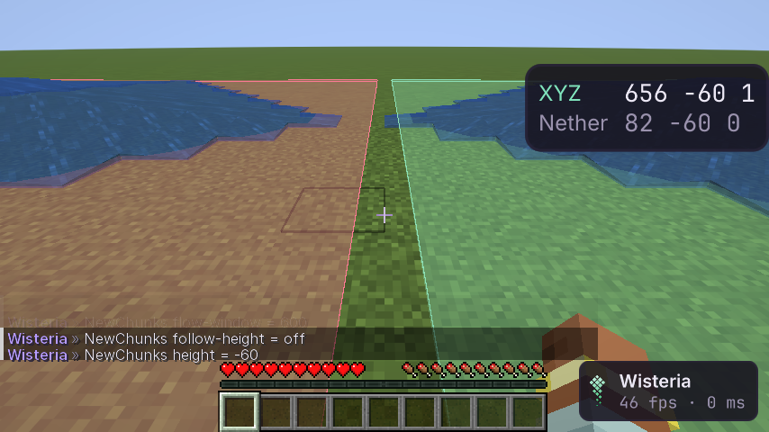

# NewChunks

Отличает только что сгенерированные чанки от старых по тому, что сервер присылает о жидкостях. Старые чанки среди
новых — след, где игроки уже были. Модуль **NewChunks** в панели World. Пассивный: на сервер ничего не уходит (аудит
сети), паника его гасит. Помнит только текущий сеанс и текущее измерение.

## Признаки

| Что пришло | Вывод | Почему |
|---|---|---|
| чанк уже содержит **текущую** (не источник) воду или лаву | **старый** | жидкость растеклась при прежних тиках: чанк уже жил |
| в чанке жидкость **начала течь** в первые секунды после прихода (`Flow Window`, 5 с) | **новый** | это первые тики только что созданного чанка |
| жидкость не движется | неизвестно | плиты нет |

Первый признак побеждает: старый чанк, где позже кто-то вылил ведро, остаётся старым; течение позже окна ничего не
меняет.

## Меню

`Show New`, `Show Old`, цвета, `Fill`, `Follow Height` (плиты под ногами) или `Height`, `Flow Window`, `Range`
(в чанках; сколько чанков прислать, решает сервер), `Counted`, `Clear`. Чат: `.newchunks <настройка> <значение>`.

## Что нельзя проверить без живого сервера

Шлюз проверяет оба признака на настоящих пакетах (старый чанк — вода растеклась, пока игрок был далеко; новый — вода
потекла сразу после прихода чанка), но не ложные срабатывания, которые бывают только на живом сервере:

- игрок рядом выливает воду или ломает блок у источника в первые секунды после прихода чанка — старый чанк станет «новым»;
- сервер не тикает жидкости при генерации (настройки Paper, предгенерация Chunky): новые чанки придут без течения —
  «неизвестно», а предгенерированные области целиком выглядят старыми;
- чанки, обновлённые со старых версий (смешивание рельефа), бывают с течением на краях — «новые» среди старых;
- лаг сервера дольше окна: первые тики приходят поздно — «неизвестно».

Оценить долю ложных срабатываний можно только на тестовом сервере владельца с известными границами старых областей.

## Как проверено

- Модульные тесты: оба признака, окно, «первый побеждает», ряд синтетических чанков как при полёте.
- Шлюз (`NewChunksGameTest`): старый и новый чанк на настоящих пакетах, неизвестный без жидкостей, плиты в кадре,
  `Show Old` выключается. Аудит сети: модуль включён — пакеты те же.
