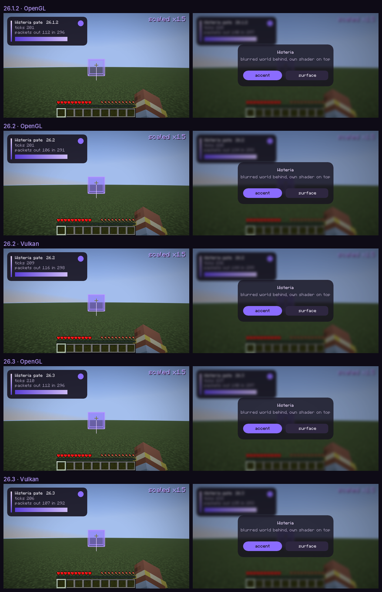

# Этап 0 — находки разведки

> **AMENDMENT_4: клиент только под 26.2 и Windows.** Разделы про 26.1.2, 26.3 и мульти-версионную сборку (8 и
> сравнения версий) оставлены как история решения; кода под другие версии в репозитории больше нет.

Обновлено 2026-11-13. Всё, что помечено «проверено вживую», получено запуском настоящего клиента Minecraft
в контейнере (Xvfb, программный рендер Mesa llvmpipe) автотестом — шлюзом версии: `tools/gate.sh`.
Шлюз лежит в `compat/common/src/gametest` и в релизный jar не попадает.

## Итог

| # | Пункт | Статус | Как проверено |
|:-:|---|:-:|---|
| 1 | Сборка | ✅ | три jar из одного исходника логики; клиент стартует на 26.1.2, 26.2, 26.3 |
| 2 | Рендер-API | ✅ | 2D, 3D и свой шейдер; проверка пикселей настоящего кадра на OpenGL и Vulkan |
| 3 | События | ✅ | tick, render2D, render3D, клавиши по именам, пакеты с отменой |
| 4 | Baritone | ✅ | официальные релизы под 26.1, 26.2 и 26.3 (по странице релизов, не запускали) |
| 5 | Grim на 2b2t | ⚠️ частично | общие факты; список «что палится» соберёт Grim-матрица на стенде владельца |
| 6 | Звук | ✅ | ogg сыгран, громкость измерена по записи звукового выхода, на всех версиях |
| 7 | 2b2t / ViaVersion | ⚠️ частично | версия сервера — по открытым источникам; живого подключения не было |
| 8 | Мульти-версия (AMENDMENT_2) | ✅ | шлюз зелёный: 26.1.2 OpenGL; 26.2 и 26.3 — OpenGL и Vulkan |
| 9 | Сид и руды (AMENDMENT_3 §6) | ⚠️ частично | hashed seed и версионность руд проверены; библиотеки — по документации |

**Гейт пройден на всех трёх версиях — этап 1 можно начинать.**

Что осталось открытым, коротко: список срабатываний Grim (нужен стенд), живой заход на 2b2t (нужен аккаунт),
настоящая видеокарта (в контейнере программный рендер), выбор способа считать руды по сиду (раздел 9).

---

## 1. Сборка

Проверено вживую. Версии, на которых реально собралось и запустилось:

| | 26.1.2 | 26.2 (Tier 1) | 26.3 |
|---|---|---|---|
| Fabric API | 0.155.3+26.1.2 | 0.161.0+26.2 | 0.166.2+26.3 |
| Java | 25 | 25 | 25 |
| Графика | только OpenGL | OpenGL, Vulkan | OpenGL, Vulkan |
| Окно и ввод | GLFW | GLFW | SDL |

Общее для всех: Fabric Loom **1.19.4** (плагин `net.fabricmc.fabric-loom`), Gradle **9.8.2** (Loom требует ≥ 9.8.0),
Fabric Loader **0.20.1**. В SPEC стояли Loom 1.17 и Gradle 9.5.1 — устарело.

Что изменилось относительно привычной схемы:

- Строки `mappings` нет, зависимости подключаются обычным `implementation`, ремаппинга нет:
  игра не обфусцирована, имена — официальные Mojang.
- Mixin-конфигу не нужен refmap, `compatibilityLevel` — `JAVA_25`.
- `./gradlew :v26_2:genSources` декомпилирует игру (Vineflower, ~1 мин). По этим исходникам проверены все сигнатуры ниже.

Грабли: Maven Central отвечает `429 Too Many Requests`, когда три версии тянут зависимости разом.
Лечится повтором и `--no-parallel` на первой сборке; дальше всё в кэше.

## 2. Рендер-API

Проверено вживую. Бэкенд форсируется аргументом запуска `--graphicsBackend OPENGL|VULKAN`
(у нас: `tools/gate.sh 26_2 VULKAN`).

Начиная с 26.1 рендер устроен в две фазы: игра сначала **собирает состояние кадра** («extract»), потом рисует его.
Мод ничего не рисует сам — он добавляет элементы в это состояние. Прямых GL-вызовов нет нигде.

### 2D: `GuiGraphicsExtractor`

`net.minecraft.client.gui.GuiGraphicsExtractor` приходит и в HUD, и в `Screen`. Этот класс и нужные методы
**одинаковы на 26.1.2, 26.2 и 26.3**:

```java
int guiWidth(); int guiHeight();
Matrix3x2fStack pose();                                   // 2D-трансформации
void fill(int x0, int y0, int x1, int y1, int argb);
void text(Font font, String str, int x, int y, int argb, boolean dropShadow);
void enableScissor(int x0, int y0, int x1, int y1); void disableScissor();
void nextStratum();                                       // новый слой поверх предыдущих
void blurBeforeThisStratum();                             // размыть всё, что ниже; один раз за кадр
public final GuiRenderState guiRenderState;               // открыт Fabric API; сюда добавляются свои элементы
```

Свой примитив — запись, реализующая `GuiElementRenderState`
(`buildVertices(VertexConsumer)`, `pipeline()`, `textureSetup()`, `scissorArea()`, `bounds()`),
добавленная через `graphics.guiRenderState.addGuiElement(...)`.

Наш `Renderer2D` построен целиком на своих элементах, а не на `fill`: это даёт дробные координаты
(анимации между пикселями) и цвет на каждый угол (горизонтальные и диагональные градиенты).

### Свой шейдер и Vulkan

Шейдеры пишутся на GLSL 330 и лежат в `assets/<ns>/shaders/core/`. На OpenGL они идут как есть,
на Vulkan игра сама компилирует их в SPIR-V (shaderc). Скруглённые прямоугольники со сглаживанием рисуются
четырьмя угловыми квадами (четверть круга, край через `fwidth`) плюс три обычных прямоугольника;
своих uniform-ов не нужно вовсе — всё в вершинах.

Описание пайплайна и сам шейдер **различаются на каждой версии** — см. раздел 8.

### 3D: `Gizmos`

`net.minecraft.gizmos.Gizmos` — высокоуровневый API для линий и боксов в мире, им рисуется ванильный debug.
Одинаков на всех трёх версиях:

```java
Gizmos.cuboid(AABB aabb, GizmoStyle style);               // GizmoStyle.stroke / fill / strokeAndFill
Gizmos.line(Vec3 start, Vec3 end, int argb, float width);
// каждый возвращает GizmoProperties:
.setAlwaysOnTop()            // видно сквозь стены — то, что нужно ESP
.persistForMillis(int) / .fadeOut()
```

Вызывать можно только там, где активен сборщик. Для ESP правильное место — событие Fabric «состояние уровня собрано»
(`END_EXTRACTION`): раз в кадр, клиентский поток, в контексте есть камера и `deltaTracker` для интерполяции.

Если гизмо не хватит (например, Chams), есть более низкий уровень: `LevelRenderEvents.*` с
`submitNodeCollector()` и `poseStack()`. Он не проверялся.

### Доказательства



Слева — мир: HUD-панель своим шейдером, горизонтальный градиент под ножницами, масштабированный текст,
бокс сквозь стены и трейсер. Справа — экран клиента: размытый мир, панель поверх.

Шлюз не только сохраняет кадры, но и проверяет пиксели: тело панели тёмное, угол панели срезан
(совпадает с небом рядом), акцентная точка фиолетовая, вокруг прицела есть сотни пикселей оттенка бокса.

Что не закрыто:

- **Размытие только во весь экран.** `blurBeforeThisStratum()` размывает всё под слоем, один раз за кадр.
  Размытие только под панелью («frosted glass») потребует своего прохода — проверять на этапе 2.
- Свой TTF-шрифт не проверялся (этап 2). В игре есть `lwjgl-freetype` и провайдер `ttf` в описании шрифтов.
- На 26.1.2 заливка бокса выглядит бледнее, чем на 26.2/26.3 (то же число, другой результат смешивания).
- Всё шло на программном рендере. На настоящих GPU — проверить руками.

## 3. События

Проверено вживую на всех трёх версиях: шлюз создаёт мир, жмёт клавишу, шлёт пакеты и падает,
если что-то не сработало.

| Событие | Откуда берём | Одинаково на 26.1–26.3 |
|---|---|:-:|
| tick | Fabric `ClientTickEvents.END_CLIENT_TICK` | да |
| render2D | Fabric `HudElementRegistry.addLast(id, (graphics, delta) -> …)` | да |
| render3D | Fabric `END_EXTRACTION` | нет: `LevelRenderEvents` на 26.1, `LevelExtractionEvents` с 26.2 |
| клавиши | миксин `KeyboardHandler.keyPress(long handle, int action, KeyEvent event)` — `@At("HEAD")` | да |
| пакет ↑ | миксин `Connection.send(Packet, ChannelFutureListener, boolean)` — `@At("HEAD"), cancellable` | да |
| пакет ↓ | миксин `Connection.channelRead0(ChannelHandlerContext, Packet)` — `@At("HEAD"), cancellable` | да |
| мышь | `MouseHandler.onButton / onScroll / onMove` (не проверялось; `onMove` на 26.3 с другой сигнатурой) | — |

Детали, на которых легко споткнуться:

- `Connection` один на клиент и встроенный сервер. Клиентское соединение — то, у которого
  `getReceiving() == PacketFlow.CLIENTBOUND`.
- **Коды клавиш зависят от версии.** До 26.2 это коды GLFW (`G` = 71), с 26.3 — сканкоды SDL (`G` = 10);
  модификаторы и «повтор» тоже закодированы иначе. Имена констант `InputConstants.KEY_*` при этом одинаковы,
  поэтому таблица «код → `Key`» компилируется под каждую версию из одного файла. В конфигах — только имена.
- Экранами с 26.2 управляет `Minecraft.gui` (`gui.setScreen(...)`), на 26.1 — сам `Minecraft`.
- Вызовы в игру — только с клиентского потока. Тестовый поток шлюза ходит через `runOnClient`.

Лог шлюза (26.2, OpenGL):

```
gate: Minecraft 26.2 on OpenGL
ok: track active while playing
ok: track still active
ok: track stopped
ok: 2D: panel drawn
ok: 2D: corner rounded
ok: 2D: accent dot
3D: 3386 tinted pixels around the crosshair
ok: 3D: box visible in a real frame
ok: key press reported by name
ok: key release reported by name
ok: outgoing packet cancelled
ok: screen open
ok: screen: panel drawn
ok: screen: accent button
ok: screen closed
tick=235 render2D=171 render3D=182
keys=[G:PRESS, G:RELEASE]
packets: sent=141 received=293 cancelled=10
gate passed: Minecraft 26.2 on OpenGL
```

Пакеты проверены на встроенном сервере (локальный канал), по сети — нет. Класс и точки внедрения те же.

## 4. Baritone

По странице релизов `cabaletta/baritone` (сами не запускали): v1.18.0 — под 26.1, **v1.19.0 — под 26.2**,
v1.20.0 — под 26.3 (в его ассетах есть Fabric-сборки и отдельный API-jar). Baritone под LGPL-3.0 — с нашим GPL-3.0 совместим.
Интеграцию (API-jar как зависимость, вызовы через `compat/`) проверять, когда дойдём до Ore tracker.

## 5. Grim на 2b2t

Собрано только общее, **списка «что точно палится» нет**. По AMENDMENT_1 его даёт живой тест владельца
на стенде с GrimAC; результаты — в [grim-matrix.md](grim-matrix.md).

Что известно:

- Grim открыт (GPL-3.0), поддерживает 1.8–26.3. Ядро — симуляция движения: сервер сам просчитывает все
  возможные перемещения игрока и сравнивает с присланным. Заявленные допуски: reach 3.01, timer 1.005, скорость 0.01 %.
- Всё компенсируется по задержке через транзакции: сервер знает, какое состояние мира клиент уже видел.
- В свежих версиях добавлены проверки порядка пакетов (PacketOrder).
- 2b2t в анонсе обновления на 1.19 писал, что античит будет строже именно к читам на движение.
  Какая у них сборка и конфиг Grim — публично не подтверждено.

Вывод для архитектуры: отправка пакетов идёт через одно место (`PacketAdapter`), где можно контролировать
порядок и частоту; дефолты модулей — в пределах симуляции.

## 6. Звук

Проверено вживую с измерением, на всех пяти прогонах. Чтобы «услышать» звук без звуковой карты, OpenAL Soft
переключён на запись в файл (`ALSOFT_DRIVERS=wave`), и уровень тона 440 Гц замерен по записи.

Как играть свой ogg, которого нет в `sounds.json` (реализовано в `CommonAudio`):

- свой класс `SoundInstance` на базе `AbstractSoundInstance` + `TickableSoundInstance`;
- поле `sound` — `new Sound(id, …, Sound.Type.FILE, stream = true, …)`;
- поток отдаёт переопределённый `getAudioStream(SoundBufferLibrary, Identifier, boolean)` — хук Fabric API;
  возвращаем `new JOrbisAudioStream(inputStream)` откуда угодно: из ресурсов или из файла в `.minecraft/wisteria/music/`;
- громкость — поле `volume`: у «тикающих» звуков движок перечитывает его каждый тик.

Отличие версий: метод, которым игра спрашивает у звука его событие, называется `resolve` до 26.2 и `getOrResolve` с 26.3.

Замер (амплитуда тона 440 Гц; числа одинаковы на 26.1.2, 26.2, 26.3 и обоих бэкендах):

| Фаза | Что сделано | Амплитуда |
|---|---|---|
| 0–2 с | трек, `volume = 1.0` | 0.1060 |
| 2–4 с | `volume = 0.25` | 0.0265 (ровно ×0.25) |
| 4–6 с | ползунок «Музыка» = 0, `volume = 1.0`, поверх — ванильный клик UI | 0.1060, клик слышен отдельно |
| после | `stop` | 0.0000 |

Ограничения, которые надо решить на этапе 5:

- С категорией `MASTER` трек зависит от **общего** ползунка громкости. Полная независимость —
  только через собственный источник OpenAL в обход `SoundEngine`.
- На паузе в одиночной игре движок глушит всё, кроме категорий `MUSIC` и `UI`.
- `volume` обрезается до 1.0 — усилить трек выше общего уровня нельзя.
- Из коробки декодируется только Ogg Vorbis. MP3 — либо конвертировать, либо тащить декодер.
- Перемотка и позиция штатно не отдаются: для прогресс-бара считать позицию самим по отданным сэмплам.

## 7. 2b2t и ViaVersion

Только по открытым источникам, **живого подключения не было**: нужен лицензионный аккаунт,
а из контейнера недоступны ни сервер, ни сервисы авторизации Mojang.

- Версия сервера — **1.21.4** (анонс на 2b2t.org от 4 июня 2025; MOTD «Updated to 1.21.4»).
- Каталоги серверов показывают принимаемый диапазон клиентов примерно 1.7.2 – 26.3.

По AMENDMENT_1 ближайшее приближение к 2b2t — второй профиль стенда: Paper 1.21.4 + GrimAC + ViaVersion, клиент 26.2.

## 8. Мульти-версия и compat-слой

Проверено вживую: один репозиторий, один исходник логики, три jar на выходе.

### Выбор сборки

Живьём попробованы оба варианта на одном и том же пустом моде под 26.1.2 / 26.2 / 26.3:

| | Stonecutter 0.10 | Обычный мульти-проект Gradle |
|---|---|---|
| Собирает три jar | да | да |
| Отличия версий | комментарии-условия внутри общих файлов | отдельные каталоги `compat/v26_x` |
| «Нет вызовов игры вне compat» | только линтером | **по построению**: у `core` игры нет в classpath |
| Зависимости сборки | Loom + плагин Stonecutter | только Loom |
| IDE | видит одну «активную» версию | видит все версии сразу |

Выбран **мульти-проект Gradle**: AMENDMENT_2 требует каталогов `compat/v26_x` и правила «прямой вызов игры
вне compat — ошибка сборки», а отдельный проект без игры в classpath даёт это без дополнительных проверок.
Stonecutter остаётся запасным вариантом, если дублирование между версиями начнёт расти.

### Как устроено

```
core/              логика, GUI, HUD, модули — чистая Java, Minecraft нет в classpath
compat/common/     реализация интерфейсов, которая компилируется без правок под каждую версию
compat/v26_1/      только то, что на 26.1.2 иначе
compat/v26_2/      только то, что на 26.2 иначе   (Tier 1)
compat/v26_3/      только то, что на 26.3 иначе
```

Интерфейсы в `core` (`dev.wisteria.compat`): `Platform`, `Renderer2D`, `Renderer3D`, `InputBackend` (+ `Key`),
`AudioBackend`, `PacketAdapter`, `ScreenBackend`. Приём, на котором держится `compat/common`: общий файл
компилируется отдельно под каждую версию, поэтому всё, что называется одинаково, но устроено по-разному
(числовые коды клавиш, порядок полей), подхватывается само.

### Что реально отличается

| Что | 26.1.2 | 26.2 | 26.3 |
|---|---|---|---|
| Описание пайплайна | uniform-ы по одному, `withVertexFormat(fmt, Mode.QUADS)` | `BindGroupLayouts.MATRICES_PROJECTION`, `withVertexBinding` + `withPrimitiveTopology` | `PROJECTION` + `DYNAMIC_TRANSFORMS`; классы в `com.mojang.renderpearl.api.pipeline` |
| Фрагментный шейдер | GLSL 330 | GLSL 330 | + `layout(location = N)` на входах и выходах |
| Событие кадра мира | `LevelRenderEvents.END_EXTRACTION` | `LevelExtractionEvents.END_EXTRACTION` | как 26.2 |
| Нажата ли клавиша | `InputConstants.isKeyDown(window, code)` | как 26.1 | `InputConstants.isKeyDown(code)` |
| Экран | `minecraft.setScreen`, `minecraft.screen` | `minecraft.gui.setScreen`, `gui.screen()` | как 26.2 |
| Имя бэкенда | `getDevice().getBackendName()` | `getDevice().getDeviceInfo().backendName()` | как 26.2 |
| Звук | `resolve` | `resolve` | `getOrResolve` |
| Тестовое API | `getClientLevel().waitForChunksRender()` | `getConnection().waitForChunksRender()` | как 26.2 |

Объём версионного кода сейчас — около 120 строк Java и один шейдер на версию, против 910 строк общей реализации.

### Грабли шлюза

- **Скриншот тестового API врёт про 3D на 26.1.2.** `takeScreenshot` рендерит отдельный кадр вне обычного цикла,
  и покадровые гизмо в него не попадают, хотя игрок их видит. Шлюз поэтому читает последний настоящий кадр
  (`Screenshot.takeScreenshot` по основной цели рендера) и проверяет пиксели в нём.
- **Игра молча меняет бэкенд.** Если запрошенный не поднялся, она стартует на другом. `tools/gate.sh` сверяет
  фактический бэкенд с запрошенным и считает расхождение провалом.
- **26.3 + OpenGL под Xvfb:** SDL не находит GLX-визуал. Нужны `libegl1` и `SDL_VIDEO_FORCE_EGL=1` (скрипт ставит сам).

Цена нового дропа по опыту 26.2 → 26.3: декомпилировать, пройтись по таблице выше, поправить версионный каталог,
прогнать шлюз. Оценка из AMENDMENT_2 (1–3 дня на версию) выглядит реалистичной.

## 9. Сид и руды (AMENDMENT_3 §6)

- [x] **Формат hashed seed — проверено вживую на 26.2.** Сервер присылает в пакетах входа и респавна
  (`CommonPlayerSpawnInfo.seed`) первые 8 байт SHA-256 от сида: сид пишется как 8 байт little-endian,
  результат читается как little-endian `long` (`BiomeManager.obfuscateSeed`). В тесте: сид `1` →
  `-6467378160175308932`, совпало с независимым расчётом. Код одинаков на 26.1.2, 26.2 и 26.3.
  Годится для быстрой проверки кандидата: один SHA-256 на кандидат.
- [x] **Версионность генерации руд — проверено по данным и коду трёх версий.**
  - 26.1.2 → 26.2: все 40 `placed_feature/ore_*` и 32 `configured_feature/ore_*` побайтно совпадают,
    `OreFeature` не менялся, списки фич у существующих биомов те же. Добавлен биом `sulfur_caves`
    (новых рудных фич не вносит). Один бэкенд на обе версии, с оговоркой про области нового биома.
  - 26.2 → 26.3: размещение (`placed_feature`) совпадает, но сами фичи переехали в `worldgen/feature/`,
    и **правила замены блоков изменились**: вместо тегов «заменяемый камень / глубинный сланец» —
    составные условия с проверкой высоты. `OreFeature` переписан под новую систему. Отдельный бэкенд для 26.3
    и отдельная проверка точности обязательны.
- [ ] **SeedcrackerX — по README, не запускали.** Есть сборки под все наши версии: 2.16.0 (26.1–26.1.2),
  2.16.1 (26.2), 2.16.2 (26.3, пререлиз). Лицензия MIT. API: зависимость `seedcrackerx-api` с JitPack,
  реализовать `kaptainwutax.seedcrackerX.api.SeedCrackerAPI` (метод `pushWorldSeed(long seed)`), зарегистрировать
  класс в `fabric.mod.json` под ключом `seedcrackerx`. На 1.18+ собирает «биты» структур и добивает перебором
  по hashed seed. JitPack из контейнера недоступен — интеграцию проверить отдельно.
- [ ] **SeedMapper — по README, не запускали.** LGPL-3.0. Внутри — форк cubiomes через FFM-привязки (jextract).
  Умеет подсветку руд и жил, есть опциональная интеграция с Baritone. **Программный API не описан** — всё через
  команды (`/sm:highlight` и т.п.), так что вариант A из AMENDMENT_3 (зависимость-библиотека) под вопросом:
  пришлось бы звать внутренние классы. Сам README предупреждает: уголь, медь и изумруды могут быть со сдвигом
  из-за зависимости от карты высот.
- [ ] **cubiomes — по README.** Лицензия MIT, язык C. Апстрим считает биомы и структуры, но
  «does not provide block-level world generation»: руд в нём нет, они есть только в форке SeedMapper.
  Вариант B означает нативные сборки под три ОС плюс собственная реализация руд поверх.

### Вариант, которого нет в AMENDMENT_3

Игра не обфусцирована, а код генерации мира общий для клиента и сервера и лежит в клиентском jar.
Значит, руды можно считать **самой игрой**: тем же `OreFeature` и теми же данными, что у сервера этой версии.
Плюсы: точное совпадение с версией по построению, никакой нативки, версионность решается сама собой через `compat/`
(`OreGenBackend` на версию). Минусы: фичи пишут в мир генерации, а не в массив, нужна подставная обёртка;
форма жилы зависит от рельефа, которого у клиента для скрытых областей нет.

Это не проверено. Рекомендация: на этапе Xray Predicted начать с часовой пробы именно этого варианта
(посчитать руды одного чанка при известном сиде и сравнить с миром), и только если не взлетит — идти в A или B.

## Решения, которые ещё нужны от владельца

1. Слоган и акцент — сейчас стоят заглушки из бренда (SPEC, раздел 0).
2. Образцы алертов Grim со стенда — для [grim-alert-format.md](grim-alert-format.md); без них Grim Lab не начать.
3. Второй профиль стенда (Paper 1.21.4 + ViaVersion) — поднимать ли.

## Как повторить

Нужны JDK 25 и, для запуска без монитора, Xvfb, Mesa (OpenGL, Vulkan, EGL) и ffmpeg для разбора звука.

```bash
./gradlew build
```

```bash
tools/gate.sh 26_2 OPENGL
```

```bash
tools/gate.sh 26_3 VULKAN
```

Кадры и запись звука попадают в `build/gate/`.

## Источники

- [Fabric example mod, ветка 26.2](https://github.com/FabricMC/fabric-example-mod/tree/26.2) — эталон сборки
- [Stonecutter: шаблон Fabric](https://github.com/stonecutter-versioning/stonecutter-template-fabric)
- [Baritone releases](https://github.com/cabaletta/baritone/releases)
- [Grim Anticheat](https://github.com/GrimAnticheat/Grim)
- [SeedcrackerX](https://github.com/19MisterX98/SeedcrackerX), [SeedMapper](https://github.com/xpple/SeedMapper), [cubiomes](https://github.com/Cubitect/cubiomes)
- [2b2t: 1.21.4 Update](https://www.2b2t.org/1-21-4-update/), [1.19 Update](https://2b2t.org/2023-08-14)
- Версии: `meta.fabricmc.net`, `maven.fabricmc.net`, `piston-meta.mojang.com`
- Сигнатуры и данные генерации: декомпилированные исходники и jar-ы Minecraft 26.1.2, 26.2, 26.3; `javap` по Fabric API
