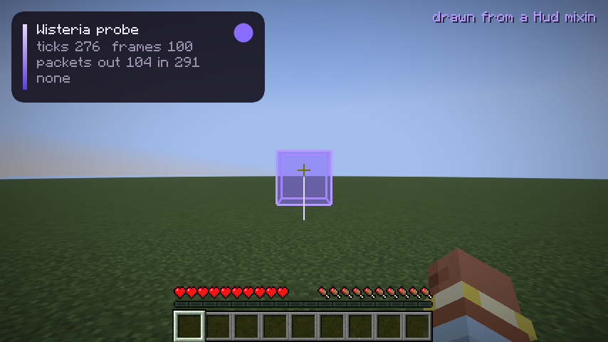
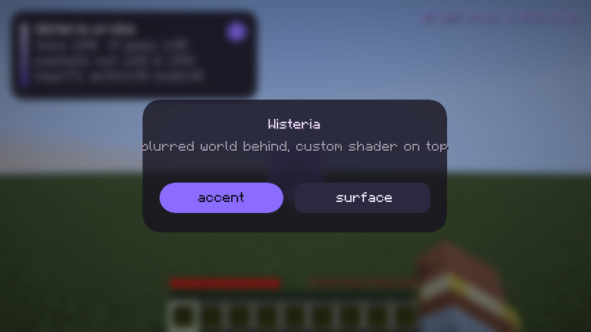

# Этап 0 — находки разведки

Дата: 2026-11-12. Всё, что помечено «проверено вживую», получено запуском настоящего клиента
Minecraft 26.2 в контейнере (Xvfb, программный рендер Mesa llvmpipe) автотестом
`./gradlew runClientGameTest`. Код проверок лежит в `src/gametest/` (мод `wisteria-probe`) и в релизный jar не попадает.

## Итог

| # | Пункт | Статус | Как проверено |
|:-:|---|:-:|---|
| 1 | Сборка | ✅ | пустой мод собран и запущен, в логе `Wisteria loaded` |
| 2 | Рендер-API | ✅ | 2D, 3D и свой шейдер нарисованы на OpenGL **и** на Vulkan, скриншоты совпадают |
| 3 | События | ✅ | tick, render2D, render3D, клавиши, пакеты (включая отмену) — счётчики в автотесте |
| 4 | Baritone | ✅ | есть официальный релиз под 26.2 (по странице релизов, не запускали) |
| 5 | Grim на 2b2t | ⚠️ частично | общие факты собраны; список «что палится» не собран |
| 6 | Звук | ✅ | ogg сыгран, громкость измерена по записи звукового выхода |
| 7 | 2b2t / ViaVersion | ⚠️ частично | версия сервера — по открытым источникам; живого подключения не было |

**Гейт (пункты 1–3 и 6) пройден — этап 1 можно начинать.**

Главная неожиданность не из списка: **26.3 уже релиз** (вышла 2026-09-15), идут снапшоты 26.4.
И порт на неё — не перекомпиляция: см. [раздел про 26.3](#263-уже-вышла-и-это-настоящий-порт).

---

## 1. Сборка

Проверено вживую. Версии, на которых реально собралось и запустилось:

| Что | Версия | Замечание |
|---|---|---|
| Minecraft | 26.2 | релиз от 2026-06-16 |
| Java | **25** | требование игры (`javaVersion.majorVersion = 25`); на 21 Loom даже не резолвится |
| Gradle | **9.8.2** | Loom 1.19 требует ≥ 9.8.0 (в SPEC было 9.5.1 — устарело) |
| Fabric Loom | **1.19.4** | плагин `net.fabricmc.fabric-loom` (в SPEC было 1.17) |
| Fabric Loader | 0.20.1 | стабильный |
| Fabric API | 0.161.0+26.2 | последний под 26.2 |

Что изменилось относительно привычной схемы:

- Плагин называется `net.fabricmc.fabric-loom`. Строки `mappings` нет, зависимости подключаются обычным
  `implementation` (не `modImplementation`), ремаппинга нет: игра не обфусцирована, имена — официальные Mojang.
- Mixin-конфигу не нужен refmap, `compatibilityLevel` — `JAVA_25`.
- `./gradlew genSources` декомпилирует игру (Vineflower, ~1 мин) — по этим исходникам проверены все сигнатуры ниже.

Лог запуска:

```
Loading Minecraft 26.2 with Fabric Loader 0.20.1
(Wisteria) Wisteria loaded
Using graphics backend OpenGL, using drivers: 4.5 (Core Profile) Mesa 25.2.8
```

Грабли: Maven Central иногда отвечает `429 Too Many Requests` на первой сборке — повтор через 20–30 секунд проходит.

## 2. Рендер-API

Проверено вживую на обоих бэкендах. Бэкенд форсируется аргументом запуска `--graphicsBackend OPENGL|VULKAN`
(у нас: `./gradlew runClientGameTest -Pbackend=VULKAN`).

В 26.2 рендер устроен в две фазы: сначала игра **собирает состояние кадра** («extract», главный поток),
потом рисует его. Мод ничего не рисует сам — он добавляет элементы в это состояние. Прямых GL-вызовов нет нигде.

### 2D: `GuiGraphicsExtractor`

`net.minecraft.client.gui.GuiGraphicsExtractor` — приходит и в HUD, и в `Screen`. Нужное нам:

```java
int guiWidth(); int guiHeight();
Matrix3x2fStack pose();                                   // 2D-трансформации: translate/scale/rotate
void fill(int x0, int y0, int x1, int y1, int argb);
void fillGradient(int x0, int y0, int x1, int y1, int argbTop, int argbBottom);   // только вертикальный
void outline(int x, int y, int width, int height, int argb);
void text(Font font, String str, int x, int y, int argb, boolean dropShadow);
void centeredText(Font font, String str, int x, int y, int argb);
void blit(...); void blitSprite(...);                     // текстуры и спрайты
void enableScissor(int x0, int y0, int x1, int y1); void disableScissor();
void nextStratum();                                       // новый слой поверх предыдущих
void blurBeforeThisStratum();                             // размыть всё, что ниже; один раз за кадр
public final GuiRenderState guiRenderState;               // открыт Fabric API; сюда добавляются свои элементы
```

Свой примитив — это запись, реализующая `GuiElementRenderState`
(`buildVertices(VertexConsumer)`, `pipeline()`, `textureSetup()`, `scissorArea()`, `bounds()`),
добавленная через `graphics.guiRenderState.addGuiElement(...)`. Пример — `CornerRenderState` в зонде.

### Свой шейдер и Vulkan

Шейдеры пишутся на GLSL 330 и лежат в `assets/<ns>/shaders/core/*.fsh|.vsh`. На OpenGL они идут как есть,
на Vulkan игра сама компилирует их в SPIR-V (`com.mojang.blaze3d.vulkan.glsl.GlslCompiler`, shaderc).
Пайплайн описывается декларативно:

```java
RenderPipeline.builder(RenderPipelines.GLOBALS_SNIPPET)
    .withBindGroupLayout(BindGroupLayouts.MATRICES_PROJECTION)   // uniform-блоки DynamicTransforms + Projection
    .withLocation(Identifier.fromNamespaceAndPath(ID, "pipeline/corner"))
    .withVertexShader("core/position_tex_color")                 // ванильный
    .withFragmentShader(Identifier.fromNamespaceAndPath(ID, "core/corner"))
    .withColorTargetState(new ColorTargetState(BlendFunction.TRANSLUCENT))
    .withVertexBinding(0, DefaultVertexFormat.POSITION_TEX_COLOR)
    .withPrimitiveTopology(PrimitiveTopology.QUADS)
    .withCull(false)
    .build();
```

Зонд рисует этим пайплайном скруглённые прямоугольники со сглаживанием: четыре угловых квада
(четверть круга, край через `fwidth`) плюс три обычных `fill`. Своих uniform-ов не нужно вовсе — всё в вершинах.
Это и есть рабочий рецепт для дизайн-системы.

### 3D: `Gizmos`

`net.minecraft.gizmos.Gizmos` — высокоуровневый API для линий и боксов в мире, им рисуется ванильный debug:

```java
Gizmos.cuboid(AABB aabb, GizmoStyle style);               // GizmoStyle.stroke / fill / strokeAndFill(argb, width, fillArgb)
Gizmos.line(Vec3 start, Vec3 end, int argb, float width);
Gizmos.rect(...); Gizmos.circle(...); Gizmos.point(...); Gizmos.arrow(...);
Gizmos.billboardText(String text, Vec3 pos, TextGizmo.Style style);
// каждый возвращает GizmoProperties:
.setAlwaysOnTop()            // видно сквозь стены — то, что нужно ESP
.persistForMillis(int) / .fadeOut()
```

Вызывать можно только там, где активен сборщик: в тике, при сборе кадра и при отрисовке.
Для ESP правильное место — событие Fabric `LevelExtractionEvents.END_EXTRACTION`: раз в кадр, главный поток,
в контексте есть `camera()` и `deltaTracker()` для интерполяции.

Если гизмо не хватит (например, Chams), есть более низкий уровень: `LevelRenderEvents.*` с
`submitNodeCollector()` и `poseStack()`. В этапе 0 он не проверялся.

### Доказательства

| | OpenGL | Vulkan |
|---|---|---|
| Мир: HUD-панель, бокс сквозь стены, трейсер |  |  |
| Экран: размытие мира, панель своим шейдером |  |  |

Попиксельное сравнение OpenGL и Vulkan: на экране с панелью отличий больше 16/255 нет вообще (0.00 %),
в мире — 0.09 % пикселей (это разные значения счётчиков в тексте панели).

Что не закрыто:

- **Размытие только во весь экран.** `blurBeforeThisStratum()` размывает всё под слоем, один раз за кадр.
  Размытие только под панелью («frosted glass») потребует своего прохода — кандидат на
  `PictureInPictureRenderer`, проверять на этапе 2.
- Ножницы: стек scissor в `GuiGraphicsExtractor` приватный, своим элементам его надо передавать самим
  (accessor-миксин или собственный стек).
- Свой TTF-шрифт не проверялся (этап 2). В игре есть `lwjgl-freetype` и провайдер `ttf` в описании шрифтов.
- Тест шёл на программном рендере. На настоящих GPU — проверить руками.

## 3. События

Проверено вживую: автотест создаёт мир, жмёт клавишу, шлёт пакеты и падает, если хоть один счётчик нулевой.

| Событие | Миксин (работает) | Готовое событие Fabric API |
|---|---|---|
| tick | `Minecraft.tick()` — `@Inject(method = "tick", at = @At("HEAD"))` | `ClientTickEvents.START/END_CLIENT_TICK` |
| render2D | `Hud.extractRenderState(GuiGraphicsExtractor, DeltaTracker)` — `@At("TAIL")` | `HudElementRegistry.addLast(id, (graphics, delta) -> …)` |
| render3D | — | `LevelExtractionEvents.END_EXTRACTION`, `LevelRenderEvents.*` |
| клавиши | `KeyboardHandler.keyPress(long handle, int action, KeyEvent event)` — `@At("HEAD")` | нет (есть только для экранов: `ScreenKeyboardEvents`) |
| пакет ↑ | `Connection.send(Packet, ChannelFutureListener, boolean)` — `@At("HEAD"), cancellable` | нет |
| пакет ↓ | `Connection.channelRead0(ChannelHandlerContext, Packet)` — `@At("HEAD"), cancellable` | нет |
| мышь | `MouseHandler.onButton / onScroll / onMove` (не проверялось) | — |

Детали, на которых легко споткнуться:

- `Connection` один на клиент и встроенный сервер. Клиентское соединение — то, у которого
  `getReceiving() == PacketFlow.CLIENTBOUND`; без этого фильтра в одиночной игре ловятся и серверные пакеты.
- `KeyEvent` — запись `(int key, int scancode, int modifiers)`; `action`: 0 отпускание, 1 нажатие, 2 повтор.
- В 26.2 экранами управляет `Minecraft.gui` (`gui.setScreen(...)`, `gui.screen()`), а HUD вынесен в отдельный `Hud`.
- Рисовать из тика нельзя — только добавлять гизмо. 2D рисуется строго в extract-фазе.

Лог автотеста (OpenGL):

```
ok: key mixin
ok: packet cancel
tick: mixin=305 fabric=305
render2D: hudMixin=162 hudFabric=162
render3D: levelExtractions=172
key: events=2 last=[key=71 action=0 mods=0]
packet: sent=135 received=293 cancelled=1
packet types sent: [Pos, PosRot, ServerboundAcceptTeleportationPacket, …, ServerboundSwingPacket, StatusOnly]
packet types received: 38 kinds, e.g. [ClientboundChangeDifficultyPacket, ClientboundChunkBatchFinishedPacket, …]
probe finished: all checks passed
```

Пакеты проверены на встроенном сервере (локальный канал), по сети — нет. Класс и точки внедрения те же.

## 4. Baritone

По странице релизов `cabaletta/baritone` (сами не запускали):

- **v1.19.0 — под 26.2**, Fabric / Forge / NeoForge;
- v1.20.0 — под 26.3 (последний релиз, 23 сентября);
- v1.18.0 — под 26.1.

Официальный билд есть, план Б не нужен. Baritone под LGPL-3.0 — с нашим GPL-3.0 совместим.
Проверка интеграции (API-jar как зависимость) — когда дойдём до Baritone-моста на этапе 6.

## 5. Grim на 2b2t

Собрано только общее, **списка «что точно палится» нет** — этот пункт не закрыт.

Что известно:

- Grim открыт (GPL-3.0), поддерживает 1.8–26.3. Ядро — симуляция движения: сервер сам просчитывает все
  возможные перемещения игрока («1:1 replication of the player's possible movements») и сравнивает с присланным.
  Заявленные допуски: reach 3.01, timer 1.005, скорость 0.01 %.
- Всё компенсируется по задержке через транзакции: сервер знает, какое состояние мира клиент уже видел.
- В свежих версиях добавлены проверки порядка пакетов (PacketOrder).
- 2b2t в анонсе обновления на 1.19 писал, что античит будет строже именно к читам на движение.
  Какая у них сборка и конфиг Grim — публично не подтверждено.

Вывод для архитектуры: всё, что меняет позицию или скорость «в лоб», античит ловит по определению,
а порядок и тайминг пакетов проверяются отдельно. Поэтому модули движения и комбата должны работать через
легитимные для симуляции состояния, а отправка пакетов — идти через одно место в ядре, где можно
контролировать порядок.

Что осталось сделать: пройтись по трекерам (Grim, Meteor, LiquidBounce, RusherHack) и собрать конкретику
по ElytraFly, Speed, Velocity, кристаллам; потом — живой тест на сервере с Grim. Разумно делать это
перед этапом 6, когда будет понятен приоритетный сценарий.

## 6. Звук

Проверено вживую с измерением. Чтобы «услышать» звук в контейнере без звуковой карты, OpenAL Soft был
переключён на запись в файл (`ALSOFT_DRIVERS=wave`), и уровень тона 440 Гц замерен по записи.

Как играть свой ogg, которого нет в `sounds.json`:

- свой класс `SoundInstance` (в зонде — `ProbeTrack extends AbstractSoundInstance implements TickableSoundInstance`);
- `resolve()` возвращает `new WeighedSoundEvents(id, null)`, поле `sound` — `new Sound(id, …, Sound.Type.FILE, stream = true, …)`;
- поток отдаёт переопределённый `getAudioStream(SoundBufferLibrary, Identifier, boolean)` — это хук Fabric API
  (`FabricSoundInstance`); возвращаем `new JOrbisAudioStream(inputStream)` откуда угодно: из ресурсов мода или из
  файла в `.minecraft/wisteria/music/`;
- запуск — `minecraft.getSoundManager().play(instance)`, остановка — `isStopped() == true`;
- громкость — поле `volume`: у «тикающих» звуков движок перечитывает его каждый тик.

Итоговая громкость = `clamp(volume, 0, 1) × ползунок категории × общий ползунок`.

Замер (амплитуда тона 440 Гц по записи выхода, OpenGL-прогон; на Vulkan-прогоне те же числа):

| Фаза | Что сделано | Амплитуда |
|---|---|---|
| 0–2 с | трек, `volume = 1.0` | 0.1060 |
| 2–4 с | `volume = 0.25` | 0.0265 (ровно ×0.25) |
| 4–6 с | ползунок «Музыка» = 0, `volume = 1.0`, поверх — ванильный клик UI | 0.1060, клик слышен отдельно |
| после | `stop` | 0.0000 |

То есть: трек играет, громкость меняется на лету, игровые звуки звучат параллельно, ползунок музыки на трек не влияет.

Ограничения, которые надо решить на этапе 5:

- С категорией `MASTER` трек всё равно зависит от **общего** ползунка громкости. Полная независимость —
  только через собственный источник OpenAL в обход `SoundEngine`.
- На паузе в одиночной игре движок глушит всё, кроме категорий `MUSIC` и `UI`. Плееру, скорее всего, нужна `MUSIC`
  или `UI` — тогда появляется зависимость от соответствующего ползунка.
- `volume` обрезается до 1.0 — усилить трек выше общего уровня нельзя.
- Из коробки декодируется только Ogg Vorbis. MP3 — либо конвертировать, либо тащить декодер.
- Перемотка и позиция трека штатно не отдаются: `AudioStream` только читает вперёд. Для прогресс-бара считать
  позицию самим по отданным сэмплам.

## 7. 2b2t и ViaVersion

Только по открытым источникам, **живого подключения не было**: нужен лицензионный аккаунт,
а из контейнера недоступны ни сервер, ни сервисы авторизации Mojang.

- Версия сервера — **1.21.4** (анонс на 2b2t.org от 4 июня 2025; MOTD «Updated to 1.21.4»).
- Каталоги серверов показывают принимаемый диапазон клиентов примерно 1.7.2 – 26.3, то есть прокси пускает 26.2.

Проверить руками: зайти клиентом 26.2 с Wisteria, пройти очередь, убедиться, что ViaVersion не ломает
то, что важно (инвентарь, элитры, кристаллы). Клиент новее сервера на полтора года — расхождения возможны.

---

## 26.3 уже вышла, и это настоящий порт

SPEC планирует 26.2, а 26.3 — «когда стабилизируется». Она стабилизировалась: релиз от 2026-09-15,
под неё есть Fabric API (0.166.2+26.3) и Baritone (v1.20.0).

Проверка: тот же зонд без правок, только версии в `gradle.properties` заменены на 26.3.
Результат — **не компилируется, 20 ошибок**. Что изменилось:

| Область | 26.2 | 26.3 |
|---|---|---|
| Рендер-слой | `com.mojang.blaze3d.*` | пайплайны и бэкенды вынесены в `com.mojang.renderpearl.*` (`api.pipeline.RenderPipeline`, `backend.opengl`, `backend.vulkan`); в `blaze3d` осталась часть классов |
| Окно и ввод | GLFW (`lwjgl-glfw`) | **SDL** (`lwjgl-sdl`), GLFW в библиотеках игры больше нет — значит, и коды клавиш другие |
| `KeyEvent` | `(key, scancode, modifiers)` | `(key, keycode, modifiers)` плюс `shortcutKey()` |
| Наборы uniform-ов | `BindGroupLayouts.MATRICES_PROJECTION` | такого поля нет (есть отдельные `DYNAMIC_TRANSFORMS`, `PROJECTION`) |
| Взмах рукой | `swing(InteractionHand)`, `ServerboundSwingPacket` | `swing(InteractionHand, SwingAnimation, boolean)`, пакета с таким именем нет |

На месте остались: `GuiGraphicsExtractor`, `GuiElementRenderState`, `Gizmos`, `KeyboardHandler.keyPress(long, int, KeyEvent)`.

Что из этого следует:

1. **Коды клавиш нельзя хранить как числа GLFW.** В конфиге бинды должны быть именами (`"KEY_G"`),
   а перевод в коды платформы — в одном месте. Иначе конфиги сломаются на 26.3.
2. **Рендер и ввод — за тонкой собственной прослойкой** (`gfx`, `input`): модули и GUI не импортируют
   `com.mojang.blaze3d` напрямую. Тогда порт затронет несколько файлов, а не весь клиент.
3. Вопрос к владельцу — с какой версии стартовать. См. ниже.

## Решения, которые нужны от владельца

1. **26.2 или сразу 26.3.** Доводы за 26.3: это текущий релиз, под неё есть Fabric API и Baritone, не придётся
   переписывать рендер и ввод через пару месяцев. Довод за 26.2: вся разведка этапа 0 сделана на ней и зелёная;
   на 26.3 её надо повторить (оценочно — день работы над зондом). Рекомендация: **перейти на 26.3 сейчас**,
   пока кода мало; этап 0 для неё перепройти тем же автотестом.
2. **Приоритетный сценарий** (PvP-кристаллы / travel-elytra / добыча+AFK) — нужен к этапу 6 и чтобы целенаправленно
   добить пункт 5.
3. Слоган и акцент — сейчас стоят заглушки из бренда (см. SPEC, раздел 0).

## Как повторить

Нужны JDK 25 и, для запуска без монитора, Xvfb с Mesa.

```bash
./gradlew build
```

```bash
xvfb-run -a ./gradlew runClientGameTest
```

```bash
xvfb-run -a ./gradlew runClientGameTest -Pbackend=VULKAN
```

Скриншоты появляются в `build/run/clientGameTest/screenshots/`. Запись звука в файл:
переменные окружения `ALSOFT_DRIVERS=wave` и `ALSOFT_CONF` с путём к конфигу вида

```ini
[general]
drivers=wave
[wave]
file=/tmp/out.wav
```

## Источники

- [Fabric example mod, ветка 26.2](https://github.com/FabricMC/fabric-example-mod/tree/26.2) — эталон сборки
- [Baritone releases](https://github.com/cabaletta/baritone/releases)
- [Grim Anticheat](https://github.com/GrimAnticheat/Grim)
- [2b2t: 1.21.4 Update](https://www.2b2t.org/1-21-4-update/), [1.19 Update](https://2b2t.org/2023-08-14)
- Версии: `meta.fabricmc.net`, `maven.fabricmc.net`, `piston-meta.mojang.com` (запрошены 2026-11-12)
- Сигнатуры: декомпилированные исходники Minecraft 26.2 (`./gradlew genSources`) и `javap` по jar-ам Fabric API
