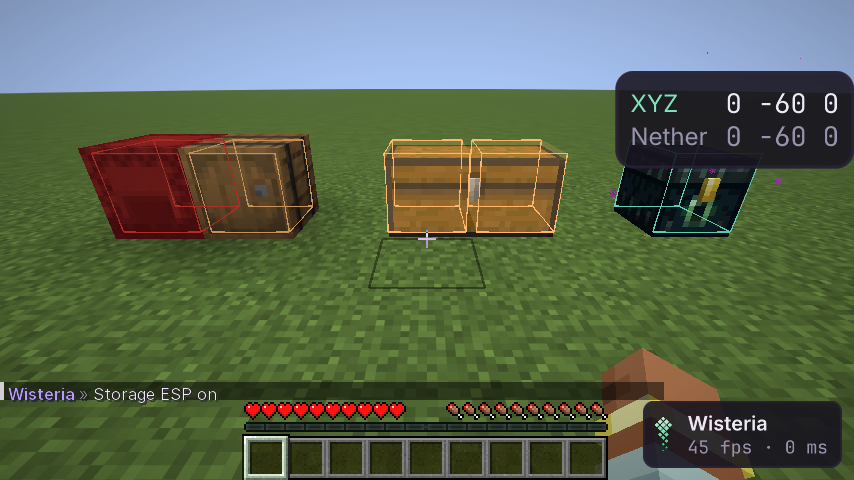
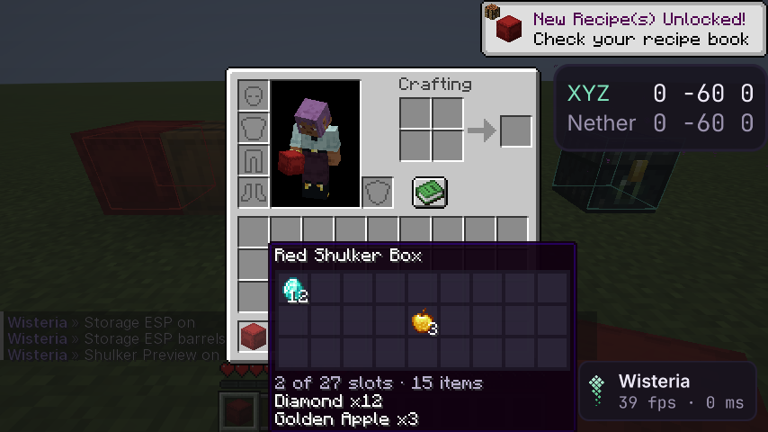

# Storage ESP и Shulker Preview

Два модуля в панели Render. Оба пассивные: на сервер ничего не уходит (аудит сети), паника гасит оба.

## Storage ESP

Рамки вокруг хранилищ по видам: **Chests** (и ловушки), **Barrels**, **Shulkers**, **Ender Chests**, **Other** (воронки,
печи, раздатчики; по умолчанию выключено). У каждого вида свой цвет; шалкеры — в цвете своего красителя (`Dye Colors`).

**Заполненность** (`Fullness`): контейнер, который вы открывали, заливается пропорционально занятым слотам (от бледной
заливки у пустого до `Fill` у полного); неоткрытый — только контур. Двойной сундук — обе половины. Это то, что сервер
показал при открытии, в этом сеансе и измерении; **Remembered** — сколько запомнено, **Forget** — забыть.

Ещё: `Range`, `Limit` (ближние первыми), `Through Walls`. Чат: `.storageesp <настройка> <значение>`.

## Shulker Preview

В подсказке шалкера в инвентаре, сундуке, творческом режиме — сетка 9×3 с предметами и количеством, под ней
`Summary`: «2 of 27 slots · 15 items». Данные — содержимое самого предмета, которое клиент уже знает. Строки игры
(первые пять предметов) остаются под сеткой.

## Дизайн

- Хранилища ищутся среди блок-сущностей загруженных чанков (`WorldBackend.containers`, как у ESP); пакет рамок
  пересобирается раз в полсекунды.
- Заполненность — из события `ContainerContent` с позицией блока, по которому кликнули; вторая половина двойного
  сундука — по его направлению соединения.
- Сетка подсказки — свой компонент подсказки (через `ClientTooltipComponentCallback` Fabric) и миксин, который спрашивает
  модуль, показывать ли сетку; рисуется предметами игры, как у мешка.

## Как проверено

- Модульные тесты: виды по id блока, цвета красителей, заполненность и заливка, сетка и строка итога.
- Шлюз (`StorageGameTest`): пять контейнеров в рамках; настоящий клик по двойному сундуку — обе половины запомнены
  как 1 из 54; неоткрытая бочка неизвестна; выключенный вид пропадает; сетка шалкера с алмазами и золотыми яблоками
  в нужных слотах, кадр с подсказкой. Аудит сети: оба модуля включены — пакеты те же.
