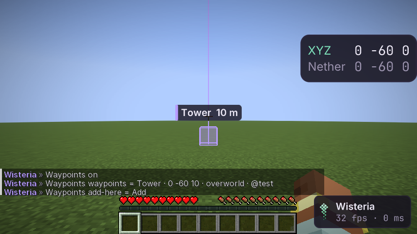

# Waypoints

Именованные точки по серверу. Модуль **Waypoints** в панели World. Пассивный: на сервер ничего не уходит
(аудит сети), паника его гасит.

## Как пользоваться

| Что | Меню | Чат |
|---|---|---|
| Добавить где стоишь | поле **Add Here**: `имя [@группа]` | `.waypoints add-here Дом @home` |
| Добавить по координатам | поле в списке **Waypoints**: `имя x y z` или `имя x z` (высота — твоя) | `.waypoints waypoints add База 100 64 -200 @bases` |
| Убрать | кнопка у строки списка | `.waypoints waypoints remove База` |
| Показать одну группу | **Group** (`all` — все) | `.waypoints group bases` |
| Убрать все метки смерти | **Clear Deaths** | `.waypoints clear-deaths` |
| Выгрузить в файл | **Export** — JSON в папку `exports` профиля | `.waypoints export` |

Настройки: `Color` (цвет новых меток), `Range`, `Beams` (луч и рамка сквозь стены), `Labels` (имя и расстояние на
экране), `Other Dimension` (метки Верхнего мира видны в Незере и наоборот, в пересчёте 8:1, с пометкой `(8:1)`),
`Death Waypoint` и `Keep Deaths` (метка на месте смерти, группа `deaths`, хранятся последние N).

## Дизайн

- Хранение: в профиле, отдельный файл на сервер (`waypoints/servers/<хеш адреса>.json`; адрес внутри файла, в имени
  только хеш). Сервер — тот же ключ, что у Seeds: адрес или `singleplayer/<мир>`.
- Метка помнит измерение, где её поставили. Конец показывает только свои.
- Подпись рисуется в 2D поверх игры: точка мира переводится на экран матрицами камеры последнего кадра
  (`platform().visuals().project(x, y, z)` — доступно любому модулю).
- Другие модули ставят метки через `Waypoints.add(...)`: BaseFinder — кнопка **Mark Waypoints** (группа `bases`).

## Как проверено

- Модульные тесты: разбор строки (имя, координаты, группа, «Farm 2» — имя, ошибки), пересчёт 8:1 в обе стороны,
  ближние первыми, текст расстояния и строки списка, хранение последних смертей.
- Шлюз (`WaypointsGameTest`): метки из чата и из поля меню, проекция подписи в центр экрана, рамка и подпись видны
  в кадре, метка смерти, сохранение через выключение, экспорт, удаление из меню. Аудит сети: модуль включён — пакеты те же.
