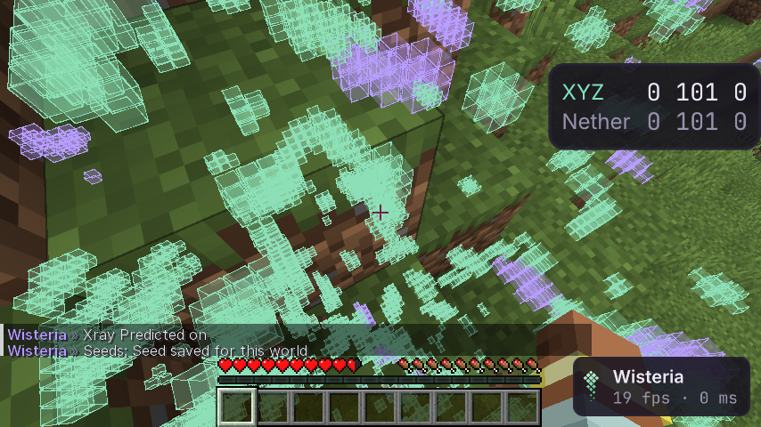

# Xray Predicted

Где сид мира кладёт руды — сквозь стены, с проверкой по тому, что видит клиент. Модуль **Xray Predicted** в панели
Render ClickGUI; сид — в **Client → Seeds**. Пассивный: на сервер не уходит ничего (проверено аудитом, ниже).

## Как пользоваться

1. Зайти на сервер, открыть ClickGUI → Client → **Seeds**, ввести сид в поле **Seed** (число или текст, из которого мир
   создан) и нажать Enter. В одиночной игре — кнопка **Use World Seed**.
2. Включить **Xray Predicted**.

**SeedcrackerX** (необязательно): если он установлен и взломал сид, сид сам попадает в Seeds для сервера, на котором
вы сейчас, с пометкой «from SeedcrackerX» (строка `Origin`). Свой, введённый вами сид он не затирает: другой найденный
сид ждёт в `SeedcrackerX` и ставится кнопкой **Use Offered Seed**. Более свежий взлом заменяет прежний взломанный.
Связь — через его API (`SeedCrackerAPI.pushWorldSeed`, точка входа `seedcrackerx`); интерфейс скопирован в клиент
без изменений под MIT (`kaptainwutax/seedcrackerX/api/SeedCrackerAPI.java`, атрибуция в файле), зависимости нет.
Клиент ничего не отправляет. Сам SeedcrackerX умеет отправлять сиды в свою базу (его настройка `databaseSubmits`) —
это его поведение, не клиента. Проверено подставным вызовом точки входа в шлюзе; с настоящим SeedcrackerX 2.16.1
**нужна живая проверка владельцем**.

Сид хранится **в профиле**, отдельно для каждого сервера (`profiles/<профиль>/data/seeds/seeds.json`), и больше нигде
не показывается. Из чата не принимается (`.seeds seed …` отвечает отказом), а строка чата, где есть сохранённый сид,
задерживается защитой чата (`docs/privacy.md`). **Forget** удаляет сид этого сервера.

## Что значат цвета

Для каждой точки, где по сиду должна быть руда, смотрим, что там видит клиент (таблица A5.1 §6):

| Клиент видит | Рисуется | Цвет по умолчанию |
|---|---|---|
| эту же руду | **подтверждено** | зелёный `Confirmed Color` |
| камень (руду спрятал анти-xray) | **предсказано** | сиреневый `Predicted Color` |
| другую руду (подделка анти-xray) | **предсказано** | сиреневый |
| чанк не загружен | **не проверено** | серый `Unverified Color` |
| воздух, воду, лаву (выкопано) | ничего | — |
| что-то другое (постройка, структура) | ничего | — |

Настройки: руды по отдельности (по умолчанию алмазы, изумруды, золото, лазурит, древние обломки), `Range` (блоки
вокруг; сколько чанков пришлёт — решает сервер), `Show Confirmed`, `Show Unverified`, цвета, `Fill`, `Line Width`,
`Through Walls`, `Limit` (не больше N рамок, ближние первыми), `Status` — что модуль делает сейчас.
Работает в обычном мире и в Незере; Энд — без руд.

## Как устроено (вариант D)

Своей генерации нет — работает код игры:

- реестры генерации мира берутся из самой игры (`VanillaRegistries`): размещённые фичи руд, биомы, шумы;
- порядок фич и их сиды — как в `ChunkGenerator.applyBiomeDecoration`: `setDecorationSeed(сид, x, z)`,
  затем `setFeatureSeed(…, номер фичи, шаг)`; фичи — штатные `OreFeature` / `ScatteredOreFeature`;
- мир для них — копии чанков, которые прислал сервер, где каждая руда возвращена в породу (камень, глубинный сланец,
  незерак); высота «дна» — по клиентским блокам без деревьев и растительности (их на шаге руд ещё нет);
  биом — клиентский, а для незагруженных чанков — из шума по сиду;
- чанк декорируется вместе с соседями 3×3 (руды переходят границы); каждая декорация делается один раз,
  в отдельном потоке, ближние чанки — первыми; игра не ждёт.

**Проба на мире с известным сидом** (`XrayGameTest`, 20 чанков, ответ — блоки сервера):

| Руда | Предсказано | Совпало | На самом деле |
|---|---|---|---|
| Алмазы, золото, лазурит | 513, 568, 504 | все | 513, 568, 504 |
| Редстоун | 752 | 751 | 751 |
| Железо | 1625 | 1620 | 1629 |
| Медь | 5963 | 5949 | 5960 |
| Уголь | 4097 | 3575 (87 %) | 3994 |

Всего (Vulkan): точность 0,961, полнота 0,969. Чанк декорируется за ≈ 9–10 мс (фоновый поток), полученный чанк
подготавливается за ≈ 1,5 мс; 20 первых чанков вместе со сборкой реестров — 1,4 с. Полный отчёт пробы шлюз
пишет в `gate/xray-probe.txt`.

**Чего не может:**

- Уголь совпадает на ≈ 87 %. У него шанс отбраковки рядом с воздухом, и случайные числа расходуются,
  только если блок подходит; если соседний чанк сгенерирован раньше и его руда уже лежит на пути, ход генерации
  дальше расходится. Порядок генерации чанков на сервере клиенту неизвестен. Ценные руды это почти не задевает.
- Жилы железа и меди из шума (с блоками сырой руды) не предсказываются: это не фичи.
- Мир должен быть сгенерирован этой версией и без датапаков, меняющих генерацию; старые чанки дадут мусор.

## Как проверено

- **Модульные тесты** (`XrayLogicTest`): каждая строка таблицы на синтетических чанках — ванильный сервер,
  анти-xray с камнем, анти-xray с поддельными рудами, постройки, незагруженные чанки; разбор сида как в игре.
- **Шлюз** (`XrayGameTest`, OpenGL и Vulkan): без сида модуль говорит, где его задать; поле сида не принимает ввод
  из чата; защита чата задерживает строку с сидом; проба выше с порогами 0,9; сервер подменяет три руды —
  на камень (остаётся «предсказано»), на другую руду («предсказано»), на воздух (пропадает); кадр с рамками;
  Forget удаляет сид.
- **Аудит сети** (`NetworkAuditGameTest`): тот же стоящий игрок 5 с с выключенным и 5 с с включённым модулем
  (с сидом, предсказание идёт): сервер получает те же пакеты тех же типов; запросов в сеть — ноль.
